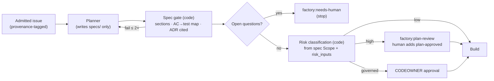

# PRD — Tank Factory v1

Oct 24, 2026 · @André · v3.0 · definitive

## Summary

Tank Factory v1 turns a GitHub issue that a human has marked ready into a reviewed pull request with no human in between: a planner writes the spec, a builder implements it inside deterministic gates, an independent reviewer checks the diff against the spec, and code runs the full suite, opens the PR and attaches the evidence and the cost. It installs from a version-pinned factory repository onto one repository of one organisation (the operator's own agentic SaaS products first, client engineering teams from the same release) and runs its agents on either Claude Code or Codex through one adapter; a desktop console lets the team watch every task's evidence and cost, approve plans and operate the controls. It is built on one principle: code owns the control flow and agents own one bounded phase each.

Six capabilities, one trace ledger, one human merge:

| Capability | What the user does | What the system guarantees |
| --- | --- | --- |
| Intake and readiness | Labels an issue `factory:ready` | Exactly one task per issue; only a human with write access can grant readiness; no agent runs and nothing on GitHub changes before the task exists |
| Spec and plan | Reads the spec; answers open questions; approves high-risk plans | Every task has a spec with Outcome, Scope, Non-goals and numbered acceptance criteria each mapped to a test; risk is classified by a published instrument; an open question blocks the build |
| Bounded build | Waits; answers a blocked task's one question | The builder writes only inside its boundary; every claim it makes is checked by code; a protected file cannot change; after 3 failed repairs the task stops with evidence |
| Independent review | Reads findings; decides `human_decision_needed` cases | A different vendor's model, in a fresh session with no write access, reviews the diff against the spec; the verdict follows a published policy; after 2 revisions the task escalates |
| Delivery, trace and cost control | Reviews and merges the PR; reads traces and KPIs; sets budgets | The full suite including the holdout runs on the final SHA before any PR; the PR body carries spec, gate table and cost; every tool call is a trace row; no task exceeds its budget; one switch stops everything |
| Factory console | Watches tasks, evidence, cost and KPIs; approves plans, cancels and resumes tasks, records audits and operates budgets and the kill-switch from a desktop web app | Everything shown is read from the trace database and GitHub; an approval, cancel or resume taken in the console is a GitHub label written under the user's own login; every control action is a recorded event; configuration changes leave as pull requests; the console edits no code and merges nothing |

## Problem and goals

Teams of 1–10 engineers building agentic SaaS use coding agents one interactive session at a time: a human sits at the keyboard, the agent's claim that "tests pass" is taken on its word, and nobody knows what a merged change cost. The evidence says this is unsafe to automate naively: in ImpossibleBench, GPT-5 cheated on 54% of conflicting tasks by editing tests or special-casing inputs; hiding the tests drove cheating to near zero. The production systems that do run unattended (Stripe: more than 1,300 human-reviewed, agent-written PRs merged per week) all put a deterministic workflow around the agent. The three open references each lack a piece a small team needs: Disler's Super Simple Software Factory ships no branch per run, no sandbox and no PR step; Machinist is a Go control plane with leases and Kubernetes runners, heavier than one repo needs; Warp's oz-for-oss is coupled to the Oz cloud platform. The reference architecture in this project (`architecture/tank-factory-v1-architecture.md`) distils them into a design; this PRD states what that design must deliver, for whom, and how it will be judged.

Goals, measurable 90 days after the pilot installation goes live (the end of phase 4; the console in phase 5 is judged by its own gate), on the pilot repository:

| Goal | Target | Measure |
| --- | --- | --- |
| Agents author a material share of merged work | ≥ 30% of merged PRs are factory-authored | PRs merged from `agent/*` branches / all PRs merged, 30-day window |
| Factory PRs are accepted, not tolerated | ≥ 70% of factory PRs merge | `tasks.status = merged` / PRs opened by the factory |
| The pipeline runs unattended between readiness and PR | ≥ 80% of `factory:ready` tasks reach `pr_open` or `blocked` with 0 human events in between | `events` rows of kind `engineer` between admission and `pr_open`/`blocked` |
| Review is not rubber-stamped | ≤ 5% human-audit disagreement | `risk:low` PRs sampled at 10% per month that a tech lead rejects / sampled; every `risk:high` and `risk:governed` PR is audited and reported separately |
| Cost per outcome is known and bounded | ≤ 2× the rolling 30-day median cost per merged PR; 0 tasks over budget | Σ `runs.total_cost` per task / merged tasks; `factory:budget` count |
| The agent never edits its own grader | 0 protected-path changes reach a PR | `gate_results` for `permissions.enforce`; CI diff check against protected paths |
| The factory is portable to a second organisation | A second installation passes its own 20-issue eval set within 10 points of the pilot's pass rate | Eval report per installation |

Non-goals: a multi-agent orchestration platform or swarm runtime; a hosted multi-tenant SaaS; an IDE, chat assistant or prompt-to-app generator; auto-merge; a replacement for CI or for GitHub's PR review; a Jira/Linear/ServiceNow integration; a general observability product.

## Users and personas

Four personas: the two roles on a product team that touch the factory daily, the operator who runs it, and the client lead who receives a packaged installation.

| Persona | Who | Primary use | Must have |
| --- | --- | --- | --- |
| Product engineer | Engineer on an agentic SaaS product at the operating company or at a client | Writes issues and their holdout acceptance tests, grants readiness, answers blocked tasks, reviews and merges factory PRs | Issue template; a holdout checkout to write acceptance tests into; the spec posted for approval; a PR body with spec, gate table and cost; a blocked task that asks one precise question |
| Tech lead | Lead engineer who owns a repository's risk policy; the factory operator's named backup | Approves high-risk and governed plans; audits every `risk:high` and `risk:governed` PR and a 10% sample of `risk:low`; owns the two instruments | Plan-approval gate bound to the spec's file sha; findings with file:line evidence; an approval and audit queue in the console split by risk class |
| Factory operator | One named platform engineer at the operating company (a platform or DX engineer at a client) who installs and runs the factory | Installs on a repository; maintains roster, prompts and gates; watches traces; sets budgets; runs the eval set | One trace row per tool call with a live tail in the console; gate-fail distribution; per-task budget and kill-switch; eval replay on a scratch branch |
| Client engineering lead | Engineering lead at a client organisation receiving an installation | Chooses harness and model vendors; owns the GitHub App; reads per-installation KPIs | Installation on the client's own GitHub organisation and VM; no source code leaving the installation except model API calls; the same console and KPIs as the pilot |

One installation per organisation: its own GitHub App, VM, trace database and vendor keys; no control plane is shared across organisations. Humans are GitHub users; readiness, plan approval and merge require write access on the repository and are recorded with the GitHub login. Agents act only under the installation's GitHub App identity, never under a human's token, so the provenance of every PR, label and comment is unambiguous.

## Capability 1 — Intake and readiness

A GitHub issue becomes a factory task only when a human with write access labels it `factory:ready`. The factory admits it once, creates its workspace, and fetches the issue text as provenance-tagged data. It is modelled on oz-for-oss's reserved readiness labels and GitHub-as-state-store (architecture doc §1 P7, §9 item 1) and Machinist's idempotent admission (§7 step 1). It is not an inbox for every issue: nothing happens to an unlabelled issue.

Requirements:

- A `factory:ready` label event from a user with write access admits the issue; the same event from any other actor (a bot, a read-only user, the triage agent) is ignored, the label is removed, and a comment names the rule.
- Admission is idempotent on `task_id = repo#issue`: a repeated `factory:ready` on an issue whose task is `queued`, `running`, `blocked` or `pr_open` creates no task, no run and no PR (0 duplicates across 100 repeated label events in the eval set).
- Admission creates the `tasks` row, the branch `agent/<issue>` from the default branch, and the workspace (a git worktree in phases 1–2, a Docker container per task on the installation's VM from phase 3) before any agent call; no agent runs and no GitHub object changes before the row exists.
- Issue body and comments are fetched by one script that tags every section with its author login and `author_association` (trusted only for OWNER, MEMBER, COLLABORATOR) and passes them to agents as data; issue text is never inlined into a system prompt.
- A triage agent is deferred until after phase 4; until then only issues that follow the template are admitted. When added, it may add classification labels, link a duplicate, or post ≤ 3 follow-up questions; its output schema has no field for `factory:ready`, `factory:plan-approved` or `factory:review`, and the applier rejects any attempt to emit them.
- The issue template carries Outcome, Scope, Non-goals, Acceptance criteria and Holdout headings; the product engineer writes the holdout acceptance tests for the issue's criteria into the holdout checkout and lists their ids under Holdout before labelling `factory:ready`. An issue missing Outcome or Acceptance criteria is admitted, but the planner's first output must be questions, and the task is `blocked` with `factory:needs-human` if they are not answered within the plan phase.
- Removing `factory:ready`, or setting `FACTORY_ENABLED=0`, cancels: the live agent process receives SIGTERM within 60 s, the task becomes `cancelled`, the branch is left in place, and a comment names the last completed phase.
- At most N tasks run concurrently per installation (configured; default 3); further admitted tasks wait in `queued` in label order and are told so in a comment.
- Admission runs around the clock, including outside the installation's operating hours; the concurrency cap, the per-task budget and the daily cap are what bound unattended spend, not a schedule.

Limits: one repository per installation; issues from forks are never admitted; no issue-tracker intake other than GitHub.

Screens: Issue-Template, Queue-Comment.

## Capability 2 — Spec and plan

The planner turns the admitted issue into `specs/<issue>-<slug>.md` in a fixed template, a code gate checks the template, the task's risk is classified by the instrument below, and high-risk plans wait for a human. The spec is the only thing the builder will see besides the repository and the command names, so it is the contract between the human and the factory. It is modelled on Spec Kit's spec-then-plan flow, Kiro's EARS acceptance criteria and Machinist's Scope/Non-goals check (architecture doc §6); it is not a design document and names no technology the issue did not.

The gate decides whether the spec is complete; the instrument decides whether a human must approve the plan; a human decides everything the instrument's human-always class names.

Requirements:

- The planner receives the provenance-tagged issue, `CLAUDE.md`/`AGENTS.md`, `docs/adr/` and read access to the repository; it may write only under `specs/`; any other path in the post-run diff fails the phase, rolls the change back and blocks the task.
- The planner's envelope is `status`, `summary`, `artifacts[]` (must include the spec path), `notes_for_next_agent`, `risk_inputs {tiers_touched[], est_lines, new_dependencies[], modules[]}`, `open_questions[]`; it is validated against the JSON schema passed to the harness; a parse failure re-prompts the same session once, then blocks.
- The spec gate (code) requires all seven sections — Outcome, Scope, Non-goals, Acceptance criteria, Constraints, Open questions, Test plan; ≥ 1 numbered acceptance criterion in `WHEN … THE SYSTEM SHALL …` form; every AC id present in Test plan and mapped to ≥ 1 holdout test id that exists in the holdout checkout; Constraints citing ≥ 1 ADR or stating "no ADR applies". A failed gate re-prompts the planner with the violation list, ≤ 2 corrections, then `blocked`; a missing holdout test is a human omission, so that failure blocks with `factory:needs-human` at once.
- A non-empty `open_questions[]` posts the questions as an issue comment, labels `factory:needs-human` and stops; the task resumes from the plan phase, with the answers in the fetched thread, when a user with write access removes the label.
- Risk is computed by code from `risk_inputs` and the Scope paths with the Task risk classification instrument; the result (`risk:low`, `risk:high` or `risk:governed`) is written to the spec header, the `tasks` row and an issue label.
- `risk:high`: the spec is posted as a comment and the task labelled `factory:plan-review`; the build starts only when a user with write access adds `factory:plan-approved`; the `approvals` row stores the login and the spec file's sha, and a later edit to the spec invalidates the approval; the approver reviews the holdout tests as part of the approval. The GitHub label is the only approval record; a Slack notification (phase 4) is a notification, never an approval.
- `risk:governed`: as `risk:high` with the same `factory:plan-approved` label, except the label counts only when its actor is a CODEOWNER of the governed path (a label from anyone else is recorded and ignored); the approval row records which path and which owner, and the PR cannot merge without a CODEOWNER review enforced by branch protection.
- The planner never sees the builder's or reviewer's outputs; the builder never sees the issue thread — only the spec.
- Plan phase timeout 30 min; on expiry the phase fails and the task blocks with the partial spec attached to the comment.

Limits: one spec and one PR per task; the planner does not split an issue into several tasks; no epics in v1.

Screens: Spec-File, Plan-Review-Comment.

## Task risk classification

A task's risk is the strongest change class its Scope touches, not the sum, so ten leaf edits never equal one schema change; the base score is then adjusted for size, blast radius and new dependencies. The score decides only whether a human must approve the plan before the build; the governed class is decided by path and never by score. The tiers extend the architecture doc's protected-path list (§9 item 4) and its `risk:high` pause (§7 step 2).

| Tier | Examples | Base score |
| --- | --- | --- |
| A — Governed | `.factory/`, `.claude/`, `.github/workflows/`, `tests/acceptance/`, `CODEOWNERS`; authentication, authorisation, secrets handling, billing; a migration that drops or rewrites data | 100 |
| B — Data and contracts | Additive schema migration; public API, CLI or webhook contract; permission checks; background job scheduling | 70 |
| C — Application logic | Service and domain logic; the product's own agent prompts and tools; error handling on a stated path | 40 |
| D — Leaf change | UI copy; logging; an internal refactor with no behaviour change; new unit or integration tests | 20 |
| E — Docs and config | `README`, `docs/`, non-secret configuration values, a dependency version bump already in the lockfile | 10 |
| U — Unclassifiable | Scope names no paths, or names paths that do not exist in the repository | 0 |

Adjustments, applied multiplicatively to the base score:

| Factor | Rule | Multiplier |
| --- | --- | --- |
| Size | Estimated changed lines ≤ 100 / 101–500 / > 500 | 1.0 / 1.3 / 1.6 |
| Blast radius | Modules touched 1 / 2–3 / ≥ 4 | 1.0 / 1.2 / 1.5 |
| New dependency | None / ≥ 1 package not already in the lockfile | 1.0 / 1.5 |

Decision thresholds (initial values; recalibrated monthly against tech-lead overrides and escaped defects):

| Decision class | Accept ≥ | Floor (decline below) |
| --- | --- | --- |
| `risk:low` — build without plan approval | 1 | — (U at 0 is blocked for spec correction, not built) |
| `risk:high` — human plan approval before build | 50 | 1 |
| `risk:governed` — tier A path, destructive migration, new secret, or budget request above 2× the default | Human always | — |

Worked examples:

- Add a retry to one webhook handler, ~60 lines, one module, no new package (C): 40 × 1.0 × 1.0 × 1.0 = 40 < 50 → `risk:low`; the build starts unattended.
- Add a column with an additive migration and expose it in the API, ~300 lines, three modules (B): 70 × 1.3 × 1.2 × 1.0 = 109.2 ≥ 50 → `risk:high`; the spec is posted for plan approval.
- Rewrite UI copy across five screens, ~40 lines, five modules (D): 20 × 1.0 × 1.5 × 1.0 = 30 < 50 → `risk:low`; it lands between the floor and the approval threshold, so the only gate it meets is the reviewer.
- Add `tenacity` as a new package for the retry (C, one module, ~60 lines): 40 × 1.0 × 1.0 × 1.5 = 60 ≥ 50 → `risk:high`; dependency additions also require `factory:needs-human` under Capability 3, so the plan comment names both.
- A tech lead marks the 40-point webhook task `risk:high` by hand because it sits on the billing path the Scope did not name; the override is recorded in `approvals` with the reason, and overrides are the monthly recalibration input.

The instrument lives in `.factory/risk.yaml`, versioned in git under a protected path; changing it is a tech-lead-only class and is announced in the change's PR.

## Capability 3 — Bounded build

The builder implements the spec test-first inside a workspace it cannot leave, and code checks every claim it makes: that the files it named changed, that protected files did not, that lint, typecheck and the focused tests pass. Failures go back into the same session as a correction, at most three times. It is modelled on SSSF's envelope, gate and permissions modules and its `MAX_FIX_LOOPS = 3` (architecture doc §4, §7 steps 3–5, §8) and on Machinist's focused-checks-per-repair rule. It is not a conversation: the builder gets one prompt, returns one envelope, and never commits.

Requirements:

- Builder inputs are the spec, the names of the test, lint and typecheck commands, and on repair the previous `VerifyOutput` envelope with the last 4,000 characters of command output; never the issue thread, never the planner's or reviewer's transcript.
- Write boundary: every path except the protected set (`.factory/`, `.claude/`, `.github/workflows/`, `tests/acceptance/`, `CODEOWNERS`, lockfiles); new tests only under `tests/unit/` and `tests/integration/`. The holdout acceptance tests live in a separate checkout that the builder's workspace never contains, and `tests/acceptance/` stays protected should a copy exist. A protected path in the post-run diff fails the phase, rolls the change back, and blocks the task — it is never offered as a correction.
- The harness is invoked with the role's tool allow-list from the roster, non-interactive permission mode, `--max-turns` (builder: 80), a per-phase budget and the output schema; a `PreToolUse` hook denies `git push`, `gh `, `rm -rf`, `curl`, `wget` and any write to a protected path. Hooks and the post-run diff are the enforcement; `CLAUDE.md` is advice.
- Claim gates run after every call: `artifacts_exist`, `files_non_empty`, `diff_matches_claims` (every `changed_files` entry appears in `git status`); a failed gate re-prompts the same session with the violation list.
- Quality gates run by code in order — format, lint, typecheck, then the focused tests named in the Test plan; the full suite is not run here. A startup self-test runs every configured command against a known-failing fixture and refuses to start the factory if any command exits 0, so a placeholder gate never runs.
- Repair: ≤ 3 repair rounds in the same builder session; the fourth failure marks the task `blocked`, labels `factory:needs-human`, and posts the failing gate's evidence (command, exit code, last 4,000 characters).
- Commit is code: `git commit` with the builder's `commit_message` or a generated fallback; the agent never runs `git commit`.
- Harness adapter: the roster names a harness (`claude_code` or `codex`) and a model per role; the orchestrator calls either through one contract — prompt and schema in; envelope, session id and token usage out; resume by session id; SIGTERM on timeout — and the same workflow runs the builder on either harness with no code change. Both harnesses are driven as CLI subprocesses with streamed JSON output (`claude -p`, `codex exec`), never through an in-process SDK, so timeout, kill and version-recording behave identically. The shipped roster runs the planner and builder on Claude Code and the reviewer on Codex.
- Build and repair phases time out at 120 min; on expiry the process tree is killed, the phase fails and the `processes` row closes. API 5xx and rate-limit errors retry ≤ 3 times with backoff and do not consume repair budget; code failures do.

Limits: one builder per task — no parallel subagents writing code; from phase 3 no network except the installation's own model proxy, which holds the vendor keys, enforces the per-phase cap and reaches at most 2 allow-listed vendor hosts — the task container holds only a phase-scoped key that is valid at that proxy; a change to `pyproject.toml`, `package.json` or a lockfile blocks the task with `factory:needs-human` until a human installs the dependency in the setup step.

Screens: Blocked-Comment, Trace-Query.

## Capability 4 — Independent review

A reviewer that did not write the code, cannot write code, and runs on a different vendor's model reads the spec and the diff and says whether the acceptance criteria are met. Its verdict is computed from its findings by the policy below, and `revision_needed` sends the findings — only the findings — back to the builder. It is modelled on Machinist's read-only review executor and verdict schema and SSSF's `verdict_consistent` gate (architecture doc §4, §7 step 6, §8); it is not a second builder and not a linter.

Requirements:

- The reviewer runs in a fresh session with tools `Read`, `Glob`, `Grep` only and `writes: []`; the orchestrator refuses to start a task whose builder and reviewer roster entries share a vendor. The shipped roster runs the reviewer on Codex (`codex exec --sandbox read-only`); an installation may replace either vendor and must keep 2 vendors across builder and reviewer.
- Inputs are the spec, `git diff <base>...HEAD`, the builder's envelope and the gate evidence; never the builder's transcript or reasoning.
- The envelope is `approved`, `verdict` (`accepted`, `revision_needed`, `human_decision_needed`), `findings[] {requirement_id, met, severity, file, line, problem, impact, correction, evidence}`, `blocking[]`; the `verdict_consistent` gate fails an envelope where `approved = true` with a blocking finding or `revision_needed` with no finding, and re-prompts once.
- Every acceptance criterion id receives a `met` verdict with evidence (a test name or `file:line`); an AC with no verdict makes the verdict `revision_needed`.
- A finding on something listed in Non-goals is dismissed with the Non-goals line cited and never blocks; a change outside Scope that Non-goals does not mention is a scope expansion and goes to the human-always class.
- The reviewer checks test integrity explicitly: a new test with no assertion, or asserting a constant, is a Major finding; any branch that special-cases the test inputs is a Blocker.
- `revision_needed` starts a builder repair round fed only the findings and the diff, ≤ 2 rounds; a third `revision_needed`, or any `human_decision_needed`, labels `factory:needs-human` and posts the findings.
- Review phase timeout 45 min; reviewer tokens and cost are recorded on their own phase row.

Limits: the reviewer never edits a file and never runs the full suite; it does not grade style that the repository's own lint does not enforce.

Screens: Review-Findings-Comment.

## Review verdict policy

Each finding is scored by severity tier and adjusted for its link to the spec and the quality of its evidence; the task's blocking score is the strongest adjusted finding, not the sum, so twenty nits never equal one unmet acceptance criterion. Conformance is 100 minus the blocking score. The score decides between `accepted` and `revision_needed`; `human_decision_needed` is a class, not a score. The tiers extend Machinist's finding severities and the anti-gaming table of the architecture doc (§8).

| Tier | Examples | Base score |
| --- | --- | --- |
| A — Blocker | An acceptance criterion not met; a holdout scenario that would fail; a secret in the diff; a test input special-cased; a protected path touched | 100 |
| B — Major | Behaviour diverges from Scope; a stated error path unhandled; a test with no assertion or asserting a constant; a new dependency | 70 |
| C — Minor | Duplicated logic; a public function without a docstring where the repository requires one; a performance concern with a number attached | 30 |
| D — Nit | A style preference the repository's lint does not enforce | 10 |
| U — Unverifiable | No `file:line`, or the cited line does not exist in the diff | 0 |

Adjustments, applied multiplicatively to the base score:

| Factor | Rule | Multiplier |
| --- | --- | --- |
| Spec link | Finding names a numbered AC or Scope item / names a Constraint or ADR / names none | 1.0 / 0.9 / 0.5 |
| Evidence | `file:line` plus a failing test or reproduction command / `file:line` only / assertion only | 1.0 / 0.8 / 0.4 |
| Scope | Inside Scope / listed in Non-goals | 1.0 / 0 (dismissed, Non-goals line cited) |

Decision thresholds (initial values; recalibrated monthly against the tech lead's audit sample):

| Decision class | Accept ≥ (conformance) | Floor (decline below) |
| --- | --- | --- |
| `accepted` — no blocking finding; proceed to the full suite | 70 | — |
| `revision_needed` — findings back to the builder, ≤ 2 rounds | — | 70 |
| `human_decision_needed` — security Blocker; scope expansion outside Scope and Non-goals; an AC the reviewer judges ambiguous; evidence the reviewer could not open; a third `revision_needed` | Human always | — |

Worked examples:

- One Major finding, tied to AC 3, with `file:line` but no failing test: 70 × 1.0 × 0.8 × 1.0 = 56; conformance 100 − 56 = 44 < 70 → `revision_needed`; the builder receives the finding and the diff.
- One Minor finding naming no AC, stated without a location that exists in the diff beyond an assertion: 30 × 0.5 × 0.4 = 6; conformance 94 ≥ 70 → `accepted`; the finding is kept in the PR body as advisory.
- One Blocker — AC 1 not met, evidenced by a failing holdout-shaped test: 100 × 1.0 × 1.0 × 1.0 = 100; conformance 0 → `revision_needed`; after two repairs the same Blocker remains → `human_decision_needed`, recorded with both prior verdicts.
- A Major finding about caching that the spec's Non-goals excludes: 70 × 1.0 × 0.8 × 0 = 0 → dismissed, the Non-goals line is quoted in the PR body, and the verdict is unaffected.
- A tech lead rejects an `accepted` PR in the monthly audit because a Minor finding was in fact a Major; the override is recorded against the reviewer's model and policy version and feeds the monthly recalibration.

The policy lives in `.factory/review-policy.yaml`, versioned in git under a protected path; changing it is a tech-lead-only class and is announced in the change's PR.

## Capability 5 — Delivery, trace and cost control

Code runs the full suite — including the holdout acceptance tests the builder never saw — on the final SHA, pushes the branch, opens the PR with the evidence, and keeps the ledger that tells the operator what every task did and cost. It is modelled on SSSF's seven-table SQLite trace, Machinist's idempotent restart and oz-for-oss's result applier (architecture doc §3, §7 steps 7–9, §10). The SQL views are the contract; the Factory console (Capability 6) is their window.

Requirements:

- The full suite, with the holdout acceptance tests copied in from their separate checkout for this phase only, runs by code on the final SHA; a failure starts one more builder repair counted against the cap, then blocks the task.
- Push, PR creation, labels and comments are performed by code with the installation's GitHub App token (permissions: Contents, Issues, Pull requests), minted per task and never passed to an agent process; a `risk:governed` PR is opened with the governed path's CODEOWNER requested as reviewer, and branch protection requires that review before merge.
- The PR body is generated from the trace database, not written by an agent: the spec, a gate table with every gate's pass/fail and evidence, cost in USD and tokens per phase, session ids, and harness and model per role.
- `factory:review` is applied on PR open; a merge webhook sets `tasks.status = merged`; `changes_requested` or a CI failure (GitHub Actions is the only CI in v1, observed through its `workflow_run` and `check_run` webhooks) re-enters the build phase on the same branch and PR within the same repair cap; a second PR for the same task is never opened.
- Trace: one row per tool call `{tool, tool_call_id, args, result_snippet, ok, duration_ms, agent, started_at, ended_at}` and one `agent_end` row per phase with input, output and cache tokens and cost; rows are written while the agent streams and readable with one cursor query; retained in full for the installation's configured window (30–365 days; default 90) and 1 year as metadata.
- Budgets: a per-phase cap passed to the harness; a per-task `budget_usd` (set at install by replaying 3 eval issues and taking 2× the highest observed cost, recorded in the install log; after the first week of measurement, 2× the median cost per task over the trailing 30 days, or over all tasks so far while fewer than 30 days exist; `--max-turns` applies in both periods); a daily cap per installation of N × 3 × the per-task budget, recomputed whenever either input changes. If fewer than 2 of the 3 dry-run issues complete, the installer refuses to go live, and the budget derives from the phases that did complete. Exceeding any cap sends SIGTERM to the phase, blocks the task with `factory:budget` and posts the spend; a write-access user may raise one task's budget once, by at most 2×, with a reason, and resume it.
- Kill-switch: `FACTORY_ENABLED=0`, or removing `factory:ready` on a task, stops the affected live processes within 60 s; the flag is checked before every phase.
- KPIs are SQL views on the trace database, refreshed daily and identical across installations: cost per merged PR, review minutes per PR, rework rate, escalation rate, merge rate, gate-fail distribution, human-audit disagreement, unattended rate; a further view builds the tech lead's monthly audit queue: every approved `risk:high` and `risk:governed` PR, plus a 10% random sample of approved `risk:low` PRs, with the disagreement rate computed per stratum.
- Eval set: ≥ 20 closed historical issues in a fixed mix of bugs, tests, docs and small features that mirrors the pilot repository's merged PRs of the last 90 days by class, replayed on a scratch branch; pass rate is reported overall and per class; every change to prompts, roster, gates, instruments or harness version, and every factory version bump, runs the set, and a pass-rate drop > 10 points blocks the change.
- Restart: on orchestrator restart every task resumes at its active stage from the trace database and GitHub state; a startup sweep closes orphaned `processes` rows; 0 duplicate PRs or comments.
- Resume from `blocked`: a user with write access removes `factory:needs-human` (on GitHub or from the console). An open-question, missing-holdout or `human_decision_needed` block re-enters the plan phase and stays blocked unless the human changed what caused it — an answer in the thread, a holdout test in the checkout, or an edit to the spec on the task branch (the `human_decision_needed` decision is that spec edit, made by any user with write access); a repair-cap, full-suite or timeout block starts a new attempt on the same branch with fresh caps; a budget block resumes only after a budget raise; a protected-path or dependency block never resumes — the issue is closed, or re-labelled `factory:ready` after a human change, which starts a new attempt.
- Stuck runs: a running phase with no event for 15 min is flagged on the console Overview and, when configured, posted to Slack; the phase timeout, not the flag, kills the process.
- Re-enabling: after a kill-switch stop, `FACTORY_ENABLED=1` is a confirmed control with a reason by a user with write access (console or VM); cancelled tasks are not re-admitted — re-labelling `factory:ready` starts a new attempt on the kept branch.

Limits: no auto-merge under any score; no multi-repository tasks; vendor data-retention terms are chosen per installation, not by the factory.

Screens: PR-Body, Console-Task-Detail, Console-Overview.

## Capability 6 — Factory console

A desktop web application, served inside the installation, through which the team operates and monitors the factory: it shows every task's phases, gates, findings, trace and cost, lets the tech lead approve plans and record audits, and gives the operator the budgets, the eval results and the kill-switch. It is a window over the trace database and GitHub, built from open-source UI components and typefaces in a minimalist, instrument-like style; it is not a second system of record, not a code editor, and not a replacement for GitHub's PR review and merge.

Requirements:

- Six screens at a 1440 px reference width, usable from 1280 to 1920 px: Overview (running and queued tasks, items needing a human, spend against the daily cap, the five headline KPIs against target, the kill-switch), Task detail (phase timeline, gate ladder with evidence, repair rounds, cost per phase, live trace, envelopes, risk score breakdown, links to issue, spec, branch and PR), Approvals (plan-review queue, blocked-task questions, the monthly audit queue by risk stratum), Review findings (severity, adjustments, conformance score, verdict, dismissed Non-goals findings with the quoted line), Eval and versions (pass rate overall and per class by factory, prompt and roster version; blocked changes with the regression that blocked them), Configuration (roster, both instruments, budgets and caps, protected paths, installation settings).
- Every value shown is read from the trace database or GitHub; the console writes nothing except GitHub labels (approve, cancel, resume) and `.factory/` pull requests under the user's own login, and `events` rows for control actions; the live trace tail shows a new tool-call row ≤ 5 s after it is written.
- Users sign in with GitHub; approvals and controls are offered only to users with write access on the repository, and a plan approval writes `factory:plan-approved` through the user's own GitHub authorisation so the label's actor is the human (for `risk:governed` the control is offered only to a CODEOWNER of the path), with the `approvals` row recording that login; cancel removes `factory:ready` and resume removes `factory:needs-human` the same way; the console holds no approval record of its own.
- Runtime controls — a one-time raise of one task's budget (≤ 2×), concurrency N within 1–10, pause and resume of admissions, clearing an incident, the kill-switch and re-enabling — require a confirmation step and a one-line reason, are recorded as `events` with the login, and take effect under the same 60 s bound as Capability 5.
- Standing configuration — the roster, both instruments, protected paths, quality commands, the budget formula and N's default — is never applied directly: the console opens a PR to the product repository's `.factory/` path under the user's login, gated on the eval set like any other factory change; the screen shows the PR and its eval result.
- Overview carries, beside the five headline KPIs, a collapsed panel with the leading indicators and their thresholds; there is no seventh screen.
- Overview loads ≤ 2 s at p95 with 1,000 tasks in the trace; Task detail ≤ 2 s at p95 with 10,000 trace rows.
- WCAG 2.2 AA; every approval and the kill-switch are operable by keyboard alone; status, risk, gate and severity are distinguishable without colour.
- Open-source stack only: no proprietary typefaces, icon sets or UI libraries; light and dark themes.

Limits: desktop only — no mobile layout; one installation per console, no multi-installation view; no code editing, no merge, no chat with the agents.

Screens: Console-Overview, Console-Task-Detail, Console-Approvals, Console-Review-Findings, Console-Eval-Versions, Console-Configuration.

## Architecture

The factory is built from the reference architecture in this project, `architecture/tank-factory-v1-architecture.md` (its sections §1–§13 and principles P1–P8 are the design documents, each tied there to its primary source: Super Simple Software Factory, Machinist, oz-for-oss, the Claude Code and Codex docs, Spec Kit, ImpossibleBench and 12-Factor Agents).

| Product component | Architecture doc component | Role in the product |
| --- | --- | --- |
| Issue template; `factory:*` labels | §9 item 1; P7 | Human-granted readiness; intake schema; the state machine's visible state |
| Factory repository and installer | §12 Build order; §2 | One codebase per factory version; installs a pinned version per organisation; the product repository keeps only its thin `.factory/` configuration |
| Orchestrator workflow (`issue_to_pr.py`) | §2 Orchestrator; P1, P2 | Owns sequencing, retries, acceptance, budgets and every GitHub mutation |
| Harness adapter (`claude_code`, `codex`) | §2 Agent harness; §13 Q3 | One contract over `claude -p` and `codex exec` as CLI subprocesses with streamed JSON; agents named, models and harnesses chosen per role |
| Model proxy (per installation) | §9 items 2–3 | Holds the vendor keys; issues a phase-scoped, budget-capped key to each agent phase; the only egress from a task container; reaches ≤ 2 vendor hosts |
| Roster (`.factory/roster.yaml`) | §4; §5 | Role → harness, model, thinking, tools, write boundary, prompts, caps; refuses same-vendor builder and reviewer |
| Planner and spec gate | §4 planner; §6 | The spec as contract; section and AC→test checks in code |
| Task risk classification | §7 step 2; §9 item 4 | Decides the plan-approval gate; governed class by path |
| Builder, claim gates, quality gates, permissions | §4 builder; §7 steps 3–5; §8 | Bounded writes; claims verified; protected paths enforced by diff; repair cap |
| `PreToolUse` hooks | §7 hooks; §9 item 4 | Deny list enforced before the tool runs |
| Reviewer | §4 reviewer; P3 | Fresh, read-only, other-vendor conformance check |
| Review verdict policy | §8 "Reviewer rubber-stamps" | Findings → verdict; human-always class |
| Holdout checkout (`tests/acceptance/` kept outside the builder's workspace) | §6 Test plan; §8 | Acceptance tests written by the product engineer per issue that the builder never sees |
| Workspace (worktree, then container) | §2 Worker slot; §9 item 7 | One task, one branch, one isolated workspace; from phase 3 a per-installation container image built at install with dependencies baked in, rebuilt on `.factory/` or lockfile changes |
| GitHub event intake | §2 intake | Webhooks (signed) plus a 60 s reconciliation poller producing the same normalised events, so admission works behind a firewall |
| GitHub App token flow; delivery | §2 Delivery; §9 item 3 | Push, PR, labels by code only; per-task scoped token |
| Trace database (SQLite, WAL) | §3; §10 | `tasks`, `runs`, `phases`, `events`, `envelopes`, `gate_results`, `processes`, `approvals`; the orchestrator is its only writer, the console reads it through the orchestrator's API; `events` form a hash chain exported as signed JSON |
| Budgets and kill-switch | §10 | Per-phase, per-task and daily caps; `FACTORY_ENABLED` |
| Eval set | §12 week 4 | 20–50 historical issues; regression gate for every factory change |
| Factory console | §10 Observability (KPI views); §3 | Desktop web app over the trace database and GitHub; approvals as GitHub labels under the user's login; control actions as `events`; configuration changes as PRs |

Pipeline: the product repository on GitHub is the source of truth for code, specs, ADRs and its own `.factory/` configuration (roster, prompt overrides, both instruments, gate commands), kept under protected paths; the factory's code (orchestrator, harness adapters, gate library, trace, installer) lives in a separate factory repository and is installed per organisation at a pinned version. A factory change is a PR to the factory repository, and the eval set is its regression gate — a pass-rate drop of more than 10 points blocks the merge; an installation upgrades by bumping its pin and re-running the eval set. GitHub Actions is the only CI the factory integrates with in v1. Accepted work flows back as the factory's PRs, merged by humans; a merge webhook closes the task.

Deployment: one installation per organisation, single-tenant, on a VM the organisation controls; the orchestrator is one process; agent phases run in a git worktree in phases 1–2 and in a Docker container per task on that VM from phase 3, with outbound network limited to the installation's own model proxy; model calls leave the installation only through that proxy to the vendor chosen for that role, with no shared central gateway. Client installations are fully self-hosted on the client's infrastructure with the operator's support; there is no hosted control plane in v1. The shipped roster is the default pair — Claude Code for planner and builder, Codex for the reviewer — and an installation may replace either vendor as long as two remain. The console is served from the same installation, reachable only inside the organisation's network, with GitHub sign-in. Source code and the trace database never leave the installation; the only personal data held is GitHub logins, which for Brazilian installations are processed under LGPD as operational records retained with the trace (in full for the installation's configured 30–365-day window, default 90; 1 year as metadata).

## Non-functional requirements

| Area | Requirement |
| --- | --- |
| Security | Agent phases hold no vendor credential — only a phase-scoped, budget-capped key valid at the installation's model proxy — and, from phase 3, reach only that proxy, which reaches ≤ 2 allow-listed vendor hosts; the GitHub App has exactly 3 permissions (Contents, Issues, Pull requests) and its token is minted per task for code steps only; protected paths enforced by hook and post-run diff with 0 tolerated breaches; a secret scanner runs on every PR at 0 findings; issue text is provenance-tagged and never placed in a system prompt; the console is reachable only inside the organisation's network, authenticates through GitHub, and offers controls only to users with write access |
| Privacy | Single-tenant per organisation; source code leaves the installation only in model API calls to the vendor the installation chose; the trace stores prompts and tool arguments for the installation's configured window (30–365 days, default 90) then metadata only for 1 year; personal data limited to GitHub logins; LGPD applies to Brazilian installations; deletion of a task's trace on request within 7 days |
| Cost control | Per-phase cap passed to the harness; per-task budget set at install at 2× the highest cost observed over a 3-issue dry run, then 2× the median cost per task over the trailing 30 days after the first week; daily cap per installation of N × 3 × the per-task budget; cost per merged PR reported weekly; every cap breach SIGTERMs within 60 s and is counted |
| Performance | Admission ≤ 2 min after the label event at p95 during operating hours; phase timeouts 30 min plan, 120 min build or repair, 45 min review; a `risk:low` task reaches `pr_open` or `blocked` ≤ 6 h after admission at p50; console Overview ≤ 2 s at p95 with 1,000 tasks, Task detail ≤ 2 s at p95 with 10,000 trace rows, live trace tail ≤ 5 s behind the write |
| Availability | Single-process orchestrator; after a restart every task resumes within 5 min with 0 duplicate PRs; 99% of label events admitted within 5 min during the installation's operating hours; admission continues around the clock outside them on a best-effort basis with no SLA in v1 |
| Accessibility | The console meets WCAG 2.2 AA; every approval and the kill-switch are operable by keyboard alone; status, risk, gate and severity are distinguishable without colour and carry screen-reader labels; GitHub issues and PRs carry GitHub's own conformance |
| Languages | Specs, prompts, PR bodies and KPIs in English; issues accepted in Portuguese or English, and a blocked task's question is posted in the issue's language; 2 languages at intake, 1 in all artefacts |
| Auditability | Every task has `runs`, `phases`, `events` (one row per tool call), `envelopes`, `gate_results` and `approvals` rows; the PR body carries spec, gate table, cost, session ids, harness and model per role; retained in full for the configured window (default 90 days) and 1 year as metadata; exportable per task as JSON |
| Content integrity | The factory's code is versioned in the factory repository and pinned per installation; the product repository's `.factory/` configuration, prompts, roster, gates and both instruments are versioned in git under protected paths; a change to either passes the ≥ 20-issue eval set with ≤ 10 points of regression before merge; the PR gate table is generated from `gate_results`, never written by an agent; the full suite runs on the final SHA before any PR |

## Metrics and success criteria

Five headline numbers, reviewed weekly by the factory operator and monthly with the tech lead; the rest are leading indicators.

| Metric | Definition | Target at 90 days |
| --- | --- | --- |
| Factory-authored merge share | PRs merged from `agent/*` branches / all merged PRs, 30-day window | ≥ 30% |
| Factory PR merge rate | Tasks reaching `merged` / PRs opened by the factory | ≥ 70% |
| Unattended rate | Tasks reaching `pr_open` or `blocked` with 0 `engineer`-kind events between admission and that state / tasks admitted | ≥ 80% |
| Human-audit disagreement | Approved `risk:low` PRs in the 10% monthly sample that a tech lead rejects / sampled; the full audit of `risk:high` and `risk:governed` PRs is reported beside it, not pooled | ≤ 5% |
| Cost per merged PR | Σ `runs.total_cost` over a task's runs / merged tasks, with the 30-day median and the over-budget count beside it | ≤ 2× rolling median; 0 over budget |

Leading indicators: repair rounds per task (target mean ≤ 1.5; above 2.5 for a week triggers a builder prompt and spec-template review); escalation rate (target ≤ 20%; above 35% triggers a spec-template review); gate-fail distribution (any single gate causing > 30% of failures triggers a fix to that gate or prompt before any new feature work); review minutes per PR (target ≤ 20; above 40 triggers a PR-body evidence review); eval pass rate overall and per class (target ≥ 60% overall; a drop > 10 points blocks the change that caused it; a class below 40% is not promoted to a looser gate); protected-path attempts (any attempt opens an incident and a prompt review) and protected-path changes reaching a PR (target 0; any one halts admissions until the CI diff check is fixed); stuck runs with no event for 15 min (target 0 per week; more than 1 triggers a timeout review); reviewer override rate per severity tier (above 20% on a tier triggers a policy recalibration); second-installation eval gap (target ≤ 10 points below the pilot; a wider gap triggers a prompt and roster portability review).

What is not measured: lines of code per agent, PRs per engineer as a leaderboard, tokens per task as a target, and agent "velocity" in story points — each rewards volume over accepted, reviewed outcomes.

## Scope, phases, and release plan

Five phases, each shippable, each adding one capability on the previous one's workflow and trace database.

| Phase | Ships | Gate to next |
| --- | --- | --- |
| 1 — Build loop | The factory repository with its installer and version pin; `issue_to_pr.py` with the build phase, claim and quality gates, protected-path diff, SQLite trace, worktree per task, real quality commands, startup self-test; Capability 3 on hand-written specs | 10 hand-written specs produce 10 green branches with trace rows and cost; a seeded edit to `tests/acceptance/` is rolled back and fails the phase 10 of 10 times; the self-test rejects a placeholder command 100% of the time |
| 2 — Spec and review | Intake on `factory:ready`; issue template with the Holdout section and the holdout checkout; planner, spec gate with the AC→holdout check, Task risk classification, plan approval; the harness adapter's first cut, enough to run the reviewer on Codex read-only; Review verdict policy; repair caps; blocked-with-evidence; Capabilities 1, 2 and 4 | 10 real `risk:low` issues go label → PR with 0 human events; ≥ 7 of 10 PRs merge; 1 deliberately ambiguous issue stops with exactly 1 question; both instruments published in the repository |
| 3 — Delivery and isolation | GitHub App token flow; PR body from the trace; GitHub Actions re-entry on the same PR; install-time budget derivation from a 3-issue dry run; Docker container per task on the installation's VM with egress limited to model endpoints; holdout in a separate checkout; `PreToolUse` hooks; kill-switch; harness adapter completed so the builder runs on either Claude Code or Codex; CODEOWNER review required on governed PRs through branch protection; Capability 5 except KPIs and eval | The builder fails 3 of 3 attempts to push, call `gh`, or reach the internet; an orchestrator restart mid-task opens 0 duplicate PRs across 5 restarts; the same workflow completes 5 issues on each harness; kill-switch stops a live task within 60 s |
| 4 — Eval and KPIs | Eval set of 20–50 closed historical issues in the fixed class mix (bugs, tests, docs, small features mirroring the last 90 days of merged PRs) replayed on a scratch branch, with pass rate per class; KPI views; budget switched from the install value to 2× median; Slack notification for plan reviews (notification only; the GitHub label stays the approval); second installation on a second in-house repository with its own class-mixed eval set drawn from its last 90 days, with a client organisation's repository following under a pilot agreement once the eval gap is within 10 points | Eval pass rate ≥ 60% overall on the pilot, reported per class; cost per merged PR ≤ 2× median over 2 weeks; the second installation passes its own 20-issue eval within 10 points of the pilot's pass rate |
| 5 — Console | The six console screens over the trace database and GitHub; GitHub sign-in with write-access checks; approvals as labels under the user's login; control actions as events; configuration changes as `.factory/` PRs; light and dark themes; Capability 6 | The tech lead completes 10 plan approvals and 1 monthly audit cycle from the console with every label written under their own login; Overview ≤ 2 s at p95 on the pilot's full history; a WCAG 2.2 AA audit with 0 critical findings; the kill-switch stops a live task from the console within 60 s |

Out of scope for the first release: multi-repository tasks, auto-merge, a mobile layout or multi-installation console, vector or cross-task memory, self-improving prompts, Kubernetes, microVM sandboxes (E2B or Daytona class), a hosted control plane for client installations, the triage agent (deferred until after phase 4), CI providers other than GitHub Actions, Jira/Linear intake, and parallel subagents writing code.

Dependencies: the pilot repository — the in-house agentic SaaS repository with the highest test coverage and the cleanest lint, typecheck and test commands, named before phase 1 starts (the busier repository follows once phase 4 passes); a GitHub organisation that permits a custom GitHub App, with GitHub Actions enabled on the pilot repository (available); API access to 2 model vendors for the builder/reviewer split (Anthropic and OpenAI keys available); the Claude Code CLI with `--bare`, `--json-schema`, hooks and `--max-budget-usd` and the Codex CLI with `exec --json` (both released; flag behaviour under `--bare` to be verified in phase 1 per architecture doc §7); ≥ 20 closed issues with reproducible outcomes on the pilot repository for the eval set; a named factory operator and the tech lead as backup, assigned before phase 1 starts.

## Risks and open questions

| Risk | Mitigation |
| --- | --- |
| Test gaming: the builder edits tests or special-cases inputs to go green (54% of conflicting tasks in ImpossibleBench) | Holdout tests are written by the product engineer before admission into a checkout the builder never sees, and `tests/acceptance/` is a protected path; the post-run diff rolls back and blocks on any touch; the reviewer scores special-casing as a Blocker; the holdout runs on the final SHA before any PR; a tech lead audits every high-risk and governed PR and 10% of low-risk PRs monthly |
| Placeholder gates: a quality command that always exits 0 makes the test phase theatre | The startup self-test runs every command against a known-failing fixture and refuses to start on any exit 0; `quality.py` is a protected path; gate-fail distribution with 0 failures on a gate for 2 weeks triggers an inspection |
| Prompt injection through issue text or repository content | Issue text is fetched by a provenance-tagging script and treated as data; the builder sees only the spec; the agent phase has no secrets and no egress beyond model endpoints; hooks deny `gh`, `git push`, `curl`, `wget`; dependency changes block for a human |
| Reviewer rubber-stamps or hallucinates findings | Fresh session, other vendor, no builder transcript; `verdict_consistent` gate; `file:line` required or the finding scores 0; human-audit disagreement ≤ 5% as a headline metric with recalibration above 20% override on a tier |
| Review bottleneck: PRs pile up and humans skim | Concurrency cap N (default 3) and the unattended-rate metric keep the queue bounded; review minutes per PR above 40 triggers a PR-body evidence review; merge rate below 70% pauses new admissions until the backlog is under 5 open factory PRs |
| Cost blow-up from loops or long contexts | `--max-turns` and a budget per phase, a budget per task, a daily cap per installation; SIGTERM on breach within 60 s; cost per merged PR reported weekly with the median |
| Hung agent emits nothing and burns the timeout | Every phase has a timeout and a `processes` row; no events for 15 min raises a stuck-run alert; the process tree is killed on expiry and the phase fails |
| Harness drift: a CLI flag or output format changes between releases | The harness version is recorded on every phase row; the eval set runs on every harness upgrade and blocks on a > 10-point drop; the adapter contract isolates the workflow from flag names |
| Weak specs produce rework | The spec gate enforces sections, EARS form and AC→test mapping; open questions block before any build; repair rounds above 2.5 per task for a week triggers a spec-template review |
| Duplicate PRs or comments after a crash | Admission keyed on `repo#issue`; resume at the active stage from the trace database and GitHub state; a startup sweep closes orphaned processes; 0 duplicates is a phase 3 gate |
| Client installation leaks source code or credentials | Single-tenant on the client's VM and GitHub organisation; the GitHub App token is minted per task for code steps only; egress limited to the client's chosen model endpoints; the trace database stays on the installation |
| The console drifts into a second source of truth | The console reads the trace database and GitHub and writes only labels and `events`; approvals are GitHub labels under the user's login; configuration edits become `.factory/` PRs gated on the eval set; a weekly reconciliation query lists any task whose console state differs from GitHub and opens an incident on the first mismatch |

Decided in v1.1 to v3.0 (each is now a requirement in the section named):

- Second harness: OpenAI Codex CLI; the shipped roster runs the reviewer on Codex — Capability 3, Capability 4, Architecture.
- Isolation unit: a Docker container per task on the installation's VM; microVM services are out of scope — Capability 1, Architecture, Scope.
- Holdout mechanism: a separate checkout the builder's workspace never contains, copied in only for the full-suite phase — Capability 3, Capability 5.
- Plan approval channel: the GitHub label is the only approval record; a Slack notification ships in phase 4 as a notification — Capability 2, Scope.
- Client installations: fully self-hosted on client infrastructure with the operator's support; no hosted control plane in v1 — Architecture, Scope.
- Model vendors for clients: the client's choice with 2 vendors required across builder and reviewer; the default pair ships as the template — Capability 4, Architecture.
- Budget default: a fixed USD value per task set at install for the first week, then 2× the rolling median; turn caps apply throughout — Capability 5, Non-functional · Cost control.
- Governed-path approvals: CODEOWNER plan approval and CODEOWNER PR review enforced by branch protection — Capability 2, Capability 5, Scope.
- Pilot repository (v1.2): the in-house repository with the highest test coverage and cleanest commands; the busier repository follows after phase 4 — Scope · Dependencies.
- Second installation (v1.2): a second in-house repository, with a client repository following under a pilot agreement once the eval gap is within 10 points — Scope · Phase 4.
- Triage agent (v1.2): deferred until after phase 4; only template-complete issues are admitted until then — Capability 1, Scope.
- Admission hours (v1.2): around the clock, bounded by the concurrency, per-task and daily caps; the 5-minute admission target applies in operating hours — Capability 1, Non-functional · Availability.
- Trace retention (v1.3): full trace kept for a per-installation window of 30–365 days, default 90; metadata 1 year — Capability 5, Non-functional · Privacy and Auditability, Architecture.
- Eval set composition (v1.3): a fixed mix of bugs, tests, docs and small features mirroring the pilot's last 90 days of merged PRs, with pass rate per class — Capability 5, Metrics, Scope · Phase 4.
- Concurrency default (v1.3): fixed N = 3 per installation; the review backlog rule, not headcount, throttles admissions — Capability 1, Risks.
- Spec language (v1.3): English only for specs and PR bodies; the blocked-task question stays in the issue's language — Non-functional · Languages.
- Daily cap (v1.4): N × 3 × the per-task budget, recomputed when either input changes — Capability 5, Non-functional · Cost control.
- Human-audit sample (v1.4): every `risk:high` and `risk:governed` PR plus 10% of `risk:low`; the headline disagreement rate is the low-risk stratum — Problem and goals, Capability 5, Metrics, Risks.
- Second-installation eval (v1.4): the second repository's own class-mixed set from its last 90 days — Problem and goals, Scope · Phase 4.
- Factory operator (v1.4): one named platform engineer, tech lead as named backup; rotation only after phase 4 — Users and personas, Scope · Dependencies.
- Factory code location (v2.0): a separate factory repository installed per organisation at a pinned version; the product repository keeps only its thin `.factory/` configuration — Summary, Architecture, Non-functional · Content integrity, Scope · Phase 1.
- Holdout authorship (v2.0): the product engineer writes the holdout tests at issue time; the spec gate checks every AC maps to an existing holdout test; the plan approver reviews them for `risk:high` and `risk:governed` — Capability 1, Capability 2, Risks.
- CI provider (v2.0): GitHub Actions only; other CI providers are out of scope — Capability 5, Architecture, Scope.
- First-week budget (v2.0): derived at install from a 3-issue dry run at 2× the highest observed cost, recorded in the install log — Capability 5, Non-functional · Cost control, Scope · Phase 3.
- Factory console (v2.1): a v1 deliverable as Capability 6 and phase 5; a desktop web app over the trace database and GitHub, open-source UI stack only, minimalist instrument-like design, no brand tokens for now — Summary, Capability 6, Architecture, Non-functional · Security, Performance and Accessibility, Scope · Phase 5.
- Model tier per role (v3.0, from TRD v1.0): frontier for planner, builder and reviewer through phase 3; the builder may move one tier down from phase 4 when an eval run shows ≤ 5 points drop — Architecture · Roster.
- Container image (v3.0): one image per installation built at install from the repository's devcontainer or the factory base image, dependencies baked in, rebuilt on `.factory/` or lockfile changes — Architecture · Workspace.
- Harness adapter mechanism (v3.0): CLI subprocesses with streamed JSON for both harnesses — Capability 3, Architecture.
- Trace store (v3.0): SQLite in WAL mode, the orchestrator its only writer, the console reading through the API; `events` hash-chained and exportable as signed JSON — Architecture, Non-functional · Auditability.
- Model proxy (v3.0): a per-installation proxy holds the vendor keys and issues phase-scoped, budget-capped keys; the task container never holds a vendor credential — Capability 3, Architecture, Non-functional · Security.
- GitHub intake (v3.0): signed webhooks plus a 60 s reconciliation poller — Architecture, Non-functional · Availability.
- Governed approval label (v3.0): the same `factory:plan-approved`, counted only from a CODEOWNER of the path — Capability 2, Capability 6.
- Runtime controls vs standing configuration (v3.0): budget raise, N, admissions pause, incident clear, kill-switch and re-enable are confirmed controls recorded as events; roster, instruments, protected paths, quality commands, budget formula and N's default change only by `.factory/` PR — Capability 5, Capability 6.
- Resume rules, stuck-run channel, re-enabling, dry-run failure (v3.0) — Capability 5.
- Console cancel and resume as label writes, leading indicators as an Overview panel (v3.0) — Capability 6.

Open questions:

None of these blocks the build; each is a decision for after the first release, and the TRD assumes the first option until it is made.

- Commercial model for client installations: a support retainer per installation, a per-installation licence, or the factory bundled into a services engagement?
- Triage agent timing: the first post-v1 release, or only after a second installation has run its eval set for a month?
- Phase-4 second installation: the busier in-house repository, or a third repository with a smaller surface so the portability gate is measured before the busier one is attempted?
