# TRD — Tank Factory v1

Oct 24, 2026 · @André · v1.0 · definitive · traces to PRD v3.0 (Oct 24, 2026) and Factory Console design package Sets 1–3 (Claude Design, Oct 23, 2026)

## 1. Purpose, scope, phases

The product turns a GitHub issue a human has labelled `factory:ready` into a reviewed pull request with no human in between, on one repository of one organisation, from a version-pinned factory repository. Each PRD phase adds one capability on the previous phase's components and must not pull forward components the next phase owns. Fixed stack, from the PRD and not re-opened below: GitHub as the system of record (a custom GitHub App with Contents, Issues and Pull requests; webhooks; GitHub Actions as the only CI; labels and branch protection as the human gates); a Python 3.12 orchestrator (`issue_to_pr.py` and its modules) as the only writer of the trace; Claude Code CLI and Codex CLI as the two harnesses; one Docker container per task on one VM the organisation controls; English artefacts; an open-source UI stack. Every other component is decided in section 2.0 with the source it implements (the reference architecture `architecture/tank-factory-v1-architecture.md`, cited as `arch §n`, and the PRD).

| Phase | Adds (architecture increment) | Must not need yet | Gate to next (PRD §Scope) |
| --- | --- | --- | --- |
| 1 — Build loop | Factory repository, `factory` installer CLI and version pin; orchestrator state machine with the build phase; harness adapter for Claude Code; claim gates, quality gates, protected-path snapshot/diff; SQLite trace (WAL) with the `events` hash chain; git worktree per task; startup self-test of quality commands | Webhook intake, planner, reviewer, LiteLLM proxy, containers, console, eval runner | 10 hand-written specs → 10 green branches with trace rows and cost; a seeded edit to `tests/acceptance/` rolled back and phase failed 10 of 10 times; self-test rejects a placeholder command 100% of the time |
| 2 — Spec and review | GitHub intake (webhook receiver + 60 s poller); issue template with Holdout; holdout checkout; planner and spec gate; risk classifier (`.factory/risk.yaml`); plan-approval wait on labels; harness adapter extended to `codex exec --sandbox read-only`; reviewer and verdict policy (`.factory/review-policy.yaml`); repair and revision caps; blocked-with-evidence comments | LiteLLM proxy, containers, PR delivery, kill-switch, console, eval runner | 10 real `risk:low` issues go label → PR with 0 `engineer` events; ≥ 7 of 10 merge; 1 ambiguous issue stops with exactly 1 question; both instruments published in the repository |
| 3 — Delivery and isolation | GitHub App installation tokens per task; PR body renderer from the trace; CI re-entry on `workflow_run` / `check_run`; LiteLLM proxy with per-phase virtual keys; per-installation task image; `factory-tasks` bridge with nftables default-DROP; `PreToolUse` hook bundle; kill-switch flag and watchdog; 3-issue dry run deriving `budget_usd`; CODEOWNER review on governed PRs | Console, eval runner, KPI views, Slack | Builder fails 3 of 3 attempts to push, call `gh` or reach the internet; orchestrator restart mid-task opens 0 duplicate PRs across 5 restarts; the same workflow completes 5 issues on each harness; kill-switch stops a live task within 60 s |
| 4 — Eval and KPIs | Eval runner on `eval/scratch`; `eval_sets`, `eval_runs`, `eval_results`; `kpi_daily` materialisation and the KPI views; audit-queue view; budget switch to 2× rolling median; Slack incoming webhook; second installation | Console | Eval pass rate ≥ 60% overall on the pilot, reported per class; cost per merged PR ≤ 2× median over 2 weeks; the second installation passes its own 20-issue eval within 10 points of the pilot |
| 5 — Console | Next.js console behind Caddy on the internal interface; GitHub App user authorisation and sessions; six screens over the orchestrator API; SSE live tail; approvals as labels under the user's token; control actions as `events`; `.factory/` change PRs under the user's token; light and dark themes | — | Tech lead completes 10 plan approvals and 1 monthly audit cycle from the console with every label under their own login; Overview ≤ 2 s p95 on the pilot's full history; WCAG 2.2 AA audit with 0 critical findings; kill-switch from the console stops a live task within 60 s |

Out of scope for the first release, per PRD: multi-repository tasks, auto-merge, a mobile layout or multi-installation console, vector or cross-task memory, self-improving prompts, Kubernetes, microVM sandboxes, a hosted control plane, the triage agent, CI providers other than GitHub Actions, Jira/Linear intake, parallel subagents writing code. The design package's seventh view (`gaps`) is a design-review artefact and is not shipped; the Approvals and Configuration screens are one route each with URL tabs, not separate screens; viewports under 1280 px receive a notice, not a layout.

Traceability rule for this document: every section names the PRD capability, non-functional row or screen it serves. A section that only restates the PRD is deleted.

## 2. C4 diagrams

One VM; four long-running processes (orchestrator, console, model proxy, edge), one ephemeral task container per running task, and one data volume holding the trace database, the holdout checkout, the workspaces and the task image cache. The reference architecture and the PRD's instruments are the design documents; the table below fixes each non-stack component with its source.

### 2.0 Component decisions (PRD §Architecture)

| Component | Candidates | Pick | Why (≤ 5 lines) | Source |
| --- | --- | --- | --- | --- |
| Trace store | SQLite 3 in WAL mode, single writer · PostgreSQL 16 | SQLite 3 WAL | One process writes (the orchestrator); WAL gives the console concurrent readers; 1,000 tasks and 10,000 trace rows are far inside SQLite's range; backup is one file. PostgreSQL adds a second service, a second credential and a second backup on a one-VM product. | arch §3, §10; PRD §Open questions |
| Workflow engine | In-process Python state machine over SQLite (`tasks.status`, `phases`, `processes`) · Temporal · LangGraph | In-process state machine | The PRD puts the control flow in code; one orchestrator process owns sequencing, caps and GitHub writes; resume is a table scan at start. Temporal is a second service plus workers for one process; LangGraph moves the loop into a library the PRD wants in plain code. | arch §2, P1; PRD §Capability 5 |
| Harness adapter mechanism | CLI subprocess with stream-json for both harnesses · Claude Agent SDK for Claude Code + CLI for Codex | CLI subprocess for both | One contract (prompt and schema in; envelope, session id, usage out; resume by session id; SIGTERM kills the process tree); the harness version is read from the binary and written on every phase row; two mechanisms would mean two lifetimes and two failure modes. | arch §2, §7; PRD §Capability 3, §Open questions |
| Task container image | Per-installation image built at install from the repository's `.devcontainer` (or a factory base image plus the repository's install command), dependencies baked in · Factory base image running the repository's setup at task start | Per-installation image, built at install and on every `.factory/` or lockfile change on `main` | Dependencies install at build time with network; the task container then needs no registry egress, which keeps the agent phase at ≤ 2 allow-listed hosts. Setup at task start needs registry access inside the agent phase and adds minutes per task. | arch §9 item 2; PRD §Non-functional · Security, §Open questions |
| Model egress and credentials | LiteLLM proxy inside the installation, holding vendor keys, issuing per-phase virtual keys with `max_budget`, allow-listing two provider hosts · Vendor keys in the container environment + host allow-list | LiteLLM proxy | The container holds only a phase-scoped virtual key valid at the proxy; vendor keys never enter the agent phase; the per-phase cap is enforced before the call; usage is logged independently of the harness. Keys in the container are a secret in the agent phase and give no second line on cost. The proxy is inside the installation, not a shared central gateway. | arch §9 items 2–3; PRD §Non-functional · Security, Cost control |
| Container egress enforcement | nftables on the host `DOCKER-USER` chain: `factory-tasks` bridge default DROP, allow only proxy IP:4000 · `--network none` with a sidecar | nftables + internal bridge | One rule set on the host, logged denials with the container id, no sidecar per task. `--network none` would also block the proxy; sidecars double the container count. | arch §9 item 2; PRD §Capability 3 Limits |
| Console framework | Next.js 15 (App Router, React 19, TypeScript) with Radix primitives, Lucide, Barlow + JetBrains Mono · FastAPI + Jinja + HTMX · SvelteKit | Next.js 15 | The design package's components (gate ladder, trace tail, approval card, kill-switch dialog) carry client logic and keyboard contracts that HTMX cannot host; the design system's React ports exist; SvelteKit has no Radix port. | PRD §Capability 6; design package Set 2 |
| Console–orchestrator contract | REST + OpenAPI 3.1 from the orchestrator (FastAPI; pydantic models shared with the envelopes) with SSE for the live tail · GraphQL · Direct SQLite reads from the console | REST + SSE | The console never opens the trace file, so the orchestrator stays the single writer; SSE is one-way, which is all the tail needs. GraphQL adds a schema layer for ~25 endpoints. | arch §3, §10; PRD §Capability 6 |
| Sign-in and GitHub identity | GitHub App user authorisation (user-to-server OAuth of the same App) with Auth.js sessions · A separate GitHub OAuth App | GitHub App user-to-server | A label written with a user-to-server token is attributed to the human and limited to the App's permissions ∩ the user's; a classic OAuth App would need the `repo` scope. | PRD §Capability 6 |
| Authorisation policy | In-code decision table (`authz.yaml` → `authz.py` and `authz.ts`) with a GitHub collaborator-permission cache, TTL 5 min · OPA | In-code decision table | About a dozen rows; the table is generated into both services from one file and tested per row; OPA is a third service for a product whose PRD forbids extra planes. Fail-closed: cache miss and GitHub unreachable → deny. | PRD §Capability 6, §Non-functional · Security |
| Edge and TLS | Caddy 2 (internal CA for the console host; public listener only for `/webhooks/github`) · nginx + certbot | Caddy 2 | One binary, automatic internal certificates, two listeners; nginx needs certbot and a hand-rolled internal CA. | PRD §Architecture · Deployment |
| GitHub event intake | Webhooks (HMAC) + 60 s reconciliation poller producing identical normalised events · Webhooks only · Polling only | Both | Webhooks give ≤ 2 min p95 admission when inbound is reachable; the poller keeps the 5-minute SLO behind firewalls and repairs missed deliveries; idempotency on `(source, github_event_id)`. | arch §2 intake; PRD §Non-functional · Availability |
| Secret scanner | gitleaks (CI on prompts and templates; at trace ingestion on `args` and `result_snippet`) · trufflehog | gitleaks | Offline rules, fast enough per row; trufflehog verifies candidates against live APIs, which is egress. | PRD §Non-functional · Security |
| Packaging and supervision | Docker Compose (orchestrator, console, litellm, caddy) under one systemd unit; `factory` installer CLI (Python, `pipx`) pinned to a git tag · Ansible · Helm | Compose + CLI | One VM, four services, one unit; Helm needs Kubernetes (out of scope); Ansible for one host is overhead. | PRD §Architecture · Pipeline |
| Observability store | The trace database read by the console; optional OTLP export of `agent_end` and `tool_call` rows behind a flag · Langfuse + Grafana | Trace database | The console is the dashboard the PRD specifies; a second store on one VM is one more thing to reconcile and back up. | arch §10; PRD §Capability 5 |
| Notifications | Slack incoming webhook (phase 4) · e-mail | Slack webhook | The PRD names Slack; notification only, never an approval. | PRD §Scope · Phase 4 |
| Export signing | Ed25519 key generated at install (PyNaCl), public key in `installation` · unsigned export | Ed25519 | A per-task JSONL export with a signed trailer is verifiable off the installation. | PRD §Non-functional · Auditability |

### 2.1 System context (PRD §Users and personas, §Architecture)

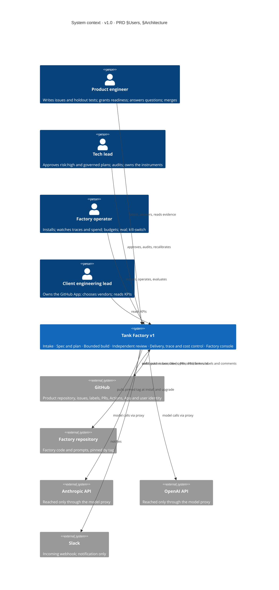

Four personas use one installation. GitHub is the only place readiness, approval and merge are recorded; the factory reads GitHub and writes back labels, comments, branches and PRs under two identities only — the App for code steps, the human's own token for approvals and configuration PRs. No agent process reaches GitHub or a model vendor directly; the model proxy is the only path out of a task container.

### 2.2 Containers (PRD §Architecture, §Deployment)

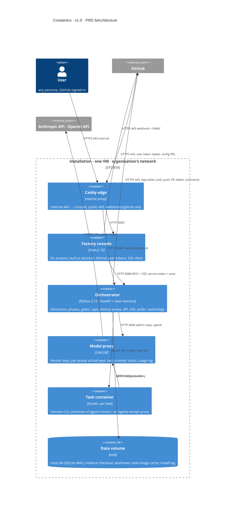

Users reach only the console through the edge on the internal interface; GitHub reaches only `/webhooks/github`. The orchestrator holds the GitHub App key and the Docker socket and is the only process that opens `trace.db` for writing; the model proxy holds the vendor keys; the console holds user tokens in encrypted sessions. A task container can reach the model proxy and nothing else.

### 2.3 Components per capability (PRD §Capability 1–6, §Users and personas · Must have)

| Capability | Components | PRD "must have" it carries | Screen |
| --- | --- | --- | --- |
| Intake and readiness (Cap. 1) | Webhook receiver (HMAC); reconciliation poller; event normaliser with `github_events` idempotency; actor-permission check; admission (task row, branch, workspace); queue scheduler (N slots, label order); issue fetcher with provenance tags; cancel handler (label removed, `FACTORY_ENABLED`) | Exactly one task per issue; human-only readiness; nothing on GitHub changes before the task exists; queue comment | Issue-Template, Queue-Comment |
| Spec and plan (Cap. 2) | Planner call (harness adapter); spec gate (sections, EARS, AC→holdout existence, ADR citation); risk classifier from `.factory/risk.yaml`; approval waiter (label events bound to spec sha, CODEOWNER check); open-question poster | Spec with mapped criteria; risk by published instrument; open question blocks; approval bound to the spec sha | Spec-File, Plan-Review-Comment, Console-Approvals |
| Bounded build (Cap. 3) | Builder call; `PreToolUse` hook bundle; permissions snapshot/diff and rollback; claim gates; quality runner (format, lint, typecheck, focused tests) with startup self-test; repair loop (cap 3); committer; timeout and budget watchdogs | Write boundary enforced by diff; claims checked by code; blocked with evidence after 3 repairs; builder never commits | Blocked-Comment, Trace-Query, Console-Task-Detail |
| Independent review (Cap. 4) | Reviewer call (other vendor, read-only); `verdict_consistent` gate; verdict policy scorer from `.factory/review-policy.yaml` (strongest finding, conformance); revision loop (cap 2); escalation poster | Fresh, read-only, other-vendor review; verdict from a published policy; escalation after 2 revisions | Review-Findings-Comment, Console-Review-Findings |
| Delivery, trace and cost control (Cap. 5) | Holdout copier and full-suite runner; App token minter; pusher and PR opener; PR body renderer; CI observer (`workflow_run`, `check_run`); merge observer; trace writer with hash chain; budget service (install derivation, median switch, daily cap); kill-switch flag and SIGTERM fan-out; KPI materialiser; audit-queue sampler; eval runner; restart sweeper; exporter | Full suite incl. holdout on the final SHA; PR body from the trace; one row per tool call; no task over budget; one switch stops everything | PR-Body, Console-Task-Detail, Console-Overview |
| Factory console (Cap. 6) | Auth.js + GitHub App user authorisation; session store; BFF route handlers; permission-aware chrome; Overview, Task detail, Approvals, Review findings, Eval and versions, Configuration views; SSE tail client; label writer (user token); audit recorder; control dialogs (reason, confirmation); `.factory/` PR composer (user token) | Read-only over trace and GitHub; approvals as labels under the user's login; every control an `events` row; no code edit, no merge | Console-Overview, Console-Task-Detail, Console-Approvals, Console-Review-Findings, Console-Eval-Versions, Console-Configuration |

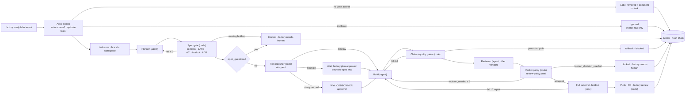

Every decision point is code reading a versioned instrument; agents appear only as the three dashed-in phases. Nothing an agent emits reaches GitHub until a code gate has verified it, and every exit — including the two that never start a task — lands in `events`.

### 2.4 Deployment (PRD §Deployment, §Non-functional · Privacy)

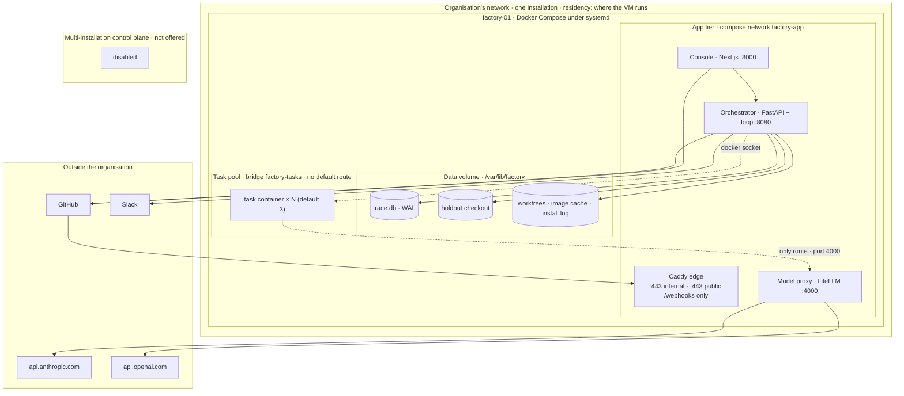

Tenancy is deployment isolation: one organisation, one VM, one `trace.db`, one GitHub App; there is no row-level tenant key because there is no second tenant. The task pool has no route to the data volume, the console, GitHub or the internet; its only route is the model proxy, and the worktree it sees is a bind mount of one branch. The multi-installation control plane the PRD excludes exists in no infrastructure.

## 3. Network topology

Five zones — organisation network, app tier, data volume, task pool, outside — with one default stance: task containers egress default-DROP; the console is reachable only on the internal interface; the public listener accepts one path. Nothing in the task pool can reach GitHub, the trace database, the holdout checkout or the console (PRD §Capability 3 Limits, §Non-functional · Security).

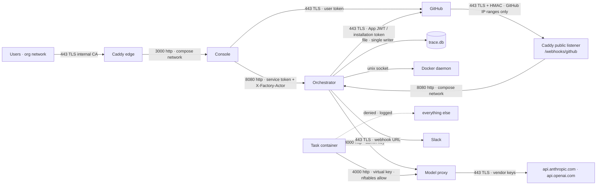

### 3.1 Conduits

| From | To | Protocol · port | Direction | Auth | Notes |
| --- | --- | --- | --- | --- | --- |
| Users (org network) | Caddy edge, internal listener | HTTPS 443 | in | TLS (Caddy internal CA); session cookie checked by the console | Console host name resolves only inside the organisation's network |
| GitHub | Caddy edge, public listener | HTTPS 443 | in | TLS; `X-Hub-Signature-256` HMAC verified by the orchestrator; source IP ∈ GitHub `hooks` ranges, refreshed daily | Only `/webhooks/github` is routed; any other path returns 404 before reaching a service |
| Caddy edge | Console | HTTP 3000 | in | compose network; edge-only ingress | — |
| Caddy edge | Orchestrator | HTTP 8080 | in | compose network; path `/webhooks/github` only | — |
| Console | Orchestrator API | HTTP 8080 | out | service token (32-byte random, rotated at install) + `X-Factory-Actor` login the console has verified | Orchestrator re-checks the actor's permission for every write |
| Console | GitHub REST | HTTPS 443 | out | user-to-server token from the signed-in user's session | Labels and `.factory/` PRs only |
| Orchestrator | GitHub REST and Git | HTTPS 443 | out | App JWT → installation token (1 h), minted per task | Poll, push, PR, labels, comments, Contents reads |
| Orchestrator | `trace.db` | file | — | process user `factory`; mode 0600 | Single writer; readers go through the API |
| Orchestrator | Holdout checkout, worktrees, image cache | file | — | process user `factory` | The holdout checkout is never mounted into a task container; the full-suite container gets it read-only |
| Task container | Its own worktree | bind mount, read-write | — | container user `agent` (uid 10001) | One branch only; `.factory/`, `.claude/`, `.github/workflows/`, `CODEOWNERS` and lockfiles are also enforced by the post-run diff |
| Orchestrator | Docker daemon | unix socket | out | socket group `factory` | Create, exec, kill task containers; never mounted into a task |
| Orchestrator | Model proxy admin | HTTP 4000 | out | LiteLLM master key (env) | Create and revoke per-phase virtual keys; read spend |
| Task container | Model proxy | HTTP 4000 | out | per-phase virtual key (env) | The only allowed destination; nftables `DOCKER-USER` rule for the `factory-tasks` bridge |
| Task container | anything else | any | out | — | Denied at host nftables (default DROP on `factory-tasks`); denial logged with container id and written as `events(kind=egress_denied)` |
| Model proxy | Anthropic API · OpenAI API | HTTPS 443 | out | vendor keys (proxy env only) | Host allow-list of exactly the configured provider hosts (≤ 2) |
| Orchestrator | Slack | HTTPS 443 | out | incoming webhook URL (env) | Phase 4; notification only |
| Orchestrator | Factory repository | HTTPS 443 | out | read-only deploy key or public | At install and upgrade only (`factory upgrade --pin vX.Y.Z`) |

### 3.2 Task container egress path

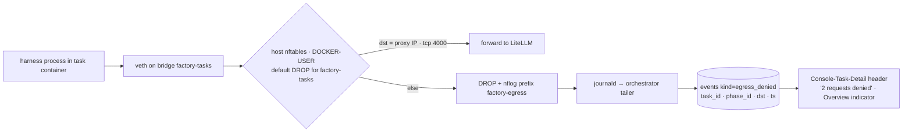

The container has one interface and no default route; the host, not the container, holds the rules, so a harness that edits its own environment cannot widen them. Every denial is a trace row and counts toward the protected-path-class incident rule in section 10 when the destination is a package registry or GitHub.

### 3.3 Residency boundary

Everything the installation stores — `trace.db`, worktrees, the holdout checkout, the task image, the install log, console sessions — lives on the organisation's VM, so residency is wherever the organisation runs it; Brazilian installations process GitHub logins under LGPD as operational records retained with the trace (PRD §Architecture · Deployment). Model providers are outside the boundary by nature: prompts and completions cross it through the model proxy and are stored on neither side beyond the trace rows the installation itself keeps and the vendors' own terms, which the installation chooses (PRD §Capability 5 Limits). GitHub holds what GitHub always holds — issues, branches, PRs, labels. The console has no region selector; a second installation is a second VM.

### 3.4 Secrets and the model-visible surface

| Secret | Lives in | Reachable by | Model-visible |
| --- | --- | --- | --- |
| GitHub App private key (PEM) | `/etc/factory/github-app.pem`, mode 0600, mounted read-only into the orchestrator | Orchestrator | No |
| GitHub App installation token (1 h) | Orchestrator memory, minted per task | Orchestrator code steps (push, PR, labels, comments) | No; never written to the trace (scanner) |
| GitHub webhook secret | Orchestrator env | Webhook receiver | No |
| Vendor API keys (Anthropic, OpenAI) | LiteLLM config via env, proxy container only | Model proxy | No |
| LiteLLM master key | Orchestrator env + proxy env | Orchestrator budget service | No |
| Per-phase LiteLLM virtual key | Task container env (`ANTHROPIC_API_KEY` or `OPENAI_API_KEY` set to the virtual key; base URL = proxy) | The harness process for that phase; `max_budget` = phase cap; revoked at phase end | No; an env value the harness reads, never serialised into a prompt; valid only at the proxy |
| Console service token | Console env + orchestrator env | Console server → orchestrator | No |
| User GitHub tokens (user-to-server) | Console `sessions` table, AES-GCM encrypted with a key in console env; 8-hour session | Console server only | No |
| Auth.js secret, session key | Console env | Console | No |
| Export signing key (Ed25519) | `/etc/factory/export.key`, mode 0600 | Orchestrator exporter | No |
| Slack webhook URL | Orchestrator env | Notifier | No |
| Docker socket | Host | Orchestrator container only | No; never mounted into a task container |

Proof: the three model-backed roles receive only the fields section 8 lists, assembled by `prompt_builder.py` from an allow-list — spec text, command names, the last 4,000 characters of a `VerifyOutput`, findings JSON, the diff — and the task container's environment is constructed explicitly (`PATH`, `HOME`, the base URL, the virtual key, `FACTORY_PHASE_ID`); no `os.environ`, header or config object is ever serialised into a prompt. gitleaks runs in CI on every file under `prompts/` and `.factory/prompts/`, and at ingestion on every `tool_call.args`, `result_snippet` and envelope payload with redaction; the required count is zero, and a hit opens an incident.

## 4. Data model

One SQLite database, `trace.db`, in WAL mode, one writer; five domains: installation and configuration, tasks and runs, trace (events, envelopes, gates, processes), approvals and audits, evaluation. A second, separate SQLite file, `console.db`, holds only the console's sessions and is written by the console alone. Trace rows are append-only: `events`, `envelopes` and `gate_results` are never updated or deleted in place (retention nulls payload columns and never removes the row before its metadata year); a changed instrument or roster is a new `config_sha`, never an edit.

### 4.1 Entity–relationship diagram (PRD §Capability 1–6)

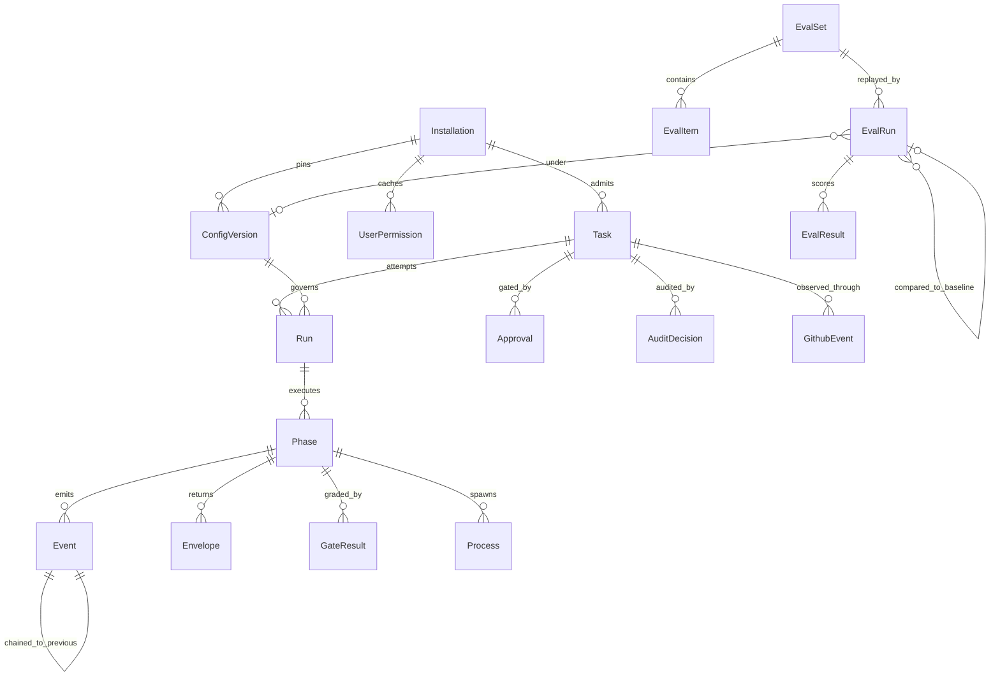

Read left to right: the installation pins configuration versions and admits tasks; a task has runs, a run has phases, and a phase emits the trace. `Approval` bridges GitHub and the trace — its `actor_login` and `bound_sha` come from a label event, its `phase_id` from the waiter that consumed it — and `EvalRun` bridges configuration and evaluation, which is why a `.factory/` change carries its eval verdict.

### 4.2 Schema (PRD §Architecture · Trace database, §Capability 5)

```sql
PRAGMA journal_mode = WAL; PRAGMA foreign_keys = ON; PRAGMA busy_timeout = 5000;

-- ----- installation and configuration -----
CREATE TABLE installation (
  id INTEGER PRIMARY KEY CHECK (id = 1),           -- singleton: one organisation per installation
  org TEXT NOT NULL, repo TEXT NOT NULL,            -- 'acme' · 'atlas-api'
  factory_version TEXT NOT NULL,                    -- pinned tag of the factory repository
  config_sha TEXT NOT NULL,                         -- current .factory/ tree sha on main
  concurrency_n INTEGER NOT NULL DEFAULT 3 CHECK (concurrency_n BETWEEN 1 AND 10),
  budget_mode TEXT NOT NULL DEFAULT 'install' CHECK (budget_mode IN ('install','median')),
  per_task_budget_usd REAL NOT NULL CHECK (per_task_budget_usd > 0),  -- install: 2× max dry-run cost; median: 2× rolling 30-day median
  daily_cap_usd REAL NOT NULL,                      -- always concurrency_n × 3 × per_task_budget_usd (recomputed by trigger)
  retention_days INTEGER NOT NULL DEFAULT 90 CHECK (retention_days BETWEEN 30 AND 365),
  factory_enabled INTEGER NOT NULL DEFAULT 1 CHECK (factory_enabled IN (0,1)),
  admissions_paused INTEGER NOT NULL DEFAULT 0,     -- review-backlog rule, see 6.4
  export_pubkey TEXT NOT NULL, timezone TEXT NOT NULL DEFAULT 'America/Sao_Paulo',
  created_at TEXT NOT NULL, updated_at TEXT NOT NULL
);
CREATE TRIGGER installation_daily_cap AFTER UPDATE OF concurrency_n, per_task_budget_usd ON installation
BEGIN UPDATE installation SET daily_cap_usd = NEW.concurrency_n * 3 * NEW.per_task_budget_usd WHERE id = 1; END;
CREATE TRIGGER installation_daily_cap_ins AFTER INSERT ON installation
BEGIN UPDATE installation SET daily_cap_usd = NEW.concurrency_n * 3 * NEW.per_task_budget_usd WHERE id = 1; END;
CREATE TABLE schema_migrations (id TEXT PRIMARY KEY, applied_at TEXT NOT NULL);  -- forward-only, one file per PR

CREATE TABLE config_versions (                      -- one row per .factory/ tree the orchestrator has loaded
  config_sha TEXT PRIMARY KEY, main_commit TEXT NOT NULL,
  roster_json TEXT NOT NULL, risk_yaml TEXT NOT NULL, review_policy_yaml TEXT NOT NULL,
  protected_paths_json TEXT NOT NULL, quality_commands_json TEXT NOT NULL,
  vendors_json TEXT NOT NULL,                       -- derived from roster; CHECK below enforces two vendors
  loaded_at TEXT NOT NULL,
  CHECK (json_extract(vendors_json, '$.builder') <> json_extract(vendors_json, '$.reviewer'))
);

CREATE TABLE user_permissions (                     -- cache of GitHub collaborator permission, TTL 5 min
  login TEXT PRIMARY KEY, permission TEXT NOT NULL CHECK (permission IN ('admin','maintain','write','triage','read','none')),
  codeowner_paths_json TEXT NOT NULL DEFAULT '[]', checked_at TEXT NOT NULL
);

-- ----- tasks and runs -----
CREATE TABLE tasks (
  task_id TEXT PRIMARY KEY,                         -- 'owner/repo#418' — the idempotency key (PRD Cap. 1)
  issue_number INTEGER NOT NULL UNIQUE, title TEXT,
  status TEXT NOT NULL CHECK (status IN ('queued','running','blocked','pr_open','merged','cancelled')),
  blocked_reason TEXT CHECK (blocked_reason IS NULL OR blocked_reason IN ('open_questions','missing_holdout','spec_gate','protected_path','repair_cap','revision_cap','human_decision_needed','budget','timeout','dependency_change','full_suite')),
  risk TEXT CHECK (risk IS NULL OR risk IN ('risk:low','risk:high','risk:governed')),
  risk_score REAL, risk_overridden_by TEXT,
  branch TEXT NOT NULL,                             -- 'agent/418'
  workspace_kind TEXT NOT NULL CHECK (workspace_kind IN ('worktree','container')),
  spec_path TEXT, spec_sha TEXT,                    -- approval is bound to spec_sha (PRD Cap. 2)
  pr_number INTEGER, pr_head_sha TEXT,
  budget_usd REAL NOT NULL, spent_usd REAL NOT NULL DEFAULT 0,
  attempt INTEGER NOT NULL DEFAULT 1,
  admitted_by TEXT NOT NULL,                        -- login of the factory:ready actor
  config_sha TEXT NOT NULL REFERENCES config_versions(config_sha),
  created_at TEXT NOT NULL, updated_at TEXT NOT NULL
);
CREATE INDEX tasks_status ON tasks(status, created_at);

CREATE TABLE runs (
  run_id TEXT PRIMARY KEY, task_id TEXT NOT NULL REFERENCES tasks(task_id),
  attempt INTEGER NOT NULL, workflow TEXT NOT NULL DEFAULT 'issue_to_pr',
  factory_version TEXT NOT NULL, config_sha TEXT NOT NULL REFERENCES config_versions(config_sha),
  status TEXT NOT NULL DEFAULT 'fail' CHECK (status IN ('running','success','fail')),  -- success must be earned
  started_at TEXT NOT NULL, ended_at TEXT,
  tokens_in INTEGER NOT NULL DEFAULT 0, tokens_out INTEGER NOT NULL DEFAULT 0, total_cost_usd REAL NOT NULL DEFAULT 0,
  UNIQUE (task_id, attempt)
);

CREATE TABLE phases (
  phase_id TEXT PRIMARY KEY, run_id TEXT NOT NULL REFERENCES runs(run_id),
  seq INTEGER NOT NULL,
  name TEXT NOT NULL CHECK (name IN ('admission','plan','spec_gate','risk','plan_approval','build','code_gates','commit','review','revision','full_suite','deliver','ci_wait')),
  kind TEXT NOT NULL CHECK (kind IN ('engineer','agent','code')),
  owner TEXT NOT NULL,                              -- 'planner' | 'builder' | 'reviewer' | 'orchestrator' | login
  status TEXT NOT NULL DEFAULT 'fail' CHECK (status IN ('running','pass','fail','skipped')),
  attempt INTEGER NOT NULL DEFAULT 1, retries INTEGER NOT NULL DEFAULT 0,
  harness TEXT, harness_version TEXT, model_id TEXT, session_id TEXT, virtual_key_id TEXT,
  timeout_s INTEGER NOT NULL, phase_cap_usd REAL,
  tokens_in INTEGER DEFAULT 0, tokens_out INTEGER DEFAULT 0, tokens_cache_read INTEGER DEFAULT 0, tokens_cache_write INTEGER DEFAULT 0,
  cost_usd REAL DEFAULT 0,
  started_at TEXT NOT NULL, ended_at TEXT, error TEXT,
  UNIQUE (run_id, seq)
);

-- ----- trace -----
CREATE TABLE events (
  seq INTEGER PRIMARY KEY AUTOINCREMENT,
  run_id TEXT REFERENCES runs(run_id), phase_id TEXT REFERENCES phases(phase_id), task_id TEXT REFERENCES tasks(task_id),
  parent_seq INTEGER REFERENCES events(seq),
  kind TEXT NOT NULL CHECK (kind IN ('phase_start','phase_end','agent_start','agent_end','tool_call','handoff','gate_pass','gate_fail',
    'log','error','webhook','poll','label_write','comment_write','control','approval','audit','egress_denied','budget_stop','purge','export','incident')),
  actor TEXT NOT NULL,                              -- role, 'orchestrator', or a login for control/approval/audit
  payload_json TEXT,                                -- tool_call: {tool, tool_call_id, args, result_snippet, ok, duration_ms, agent}; nulled by retention
  payload_hash TEXT NOT NULL,                       -- sha256 of the canonical payload; survives retention so the chain still verifies (4.3)
  tokens INTEGER, started_at TEXT, ended_at TEXT,
  created_at TEXT NOT NULL,
  prev_hash TEXT NOT NULL, hash TEXT NOT NULL UNIQUE  -- 4.3
);
CREATE INDEX events_phase ON events(phase_id, seq); CREATE INDEX events_task ON events(task_id, seq); CREATE INDEX events_kind ON events(kind, created_at);
CREATE TRIGGER events_append_only_u BEFORE UPDATE ON events
  WHEN NEW.seq <> OLD.seq OR NEW.kind <> OLD.kind OR NEW.actor <> OLD.actor OR NEW.created_at <> OLD.created_at
    OR NEW.payload_hash <> OLD.payload_hash OR NEW.prev_hash <> OLD.prev_hash OR NEW.hash <> OLD.hash
    OR (NEW.payload_json IS NOT NULL AND NEW.payload_json IS NOT OLD.payload_json)
  BEGIN SELECT RAISE(ABORT, 'events is append-only; retention may only null payload_json'); END;
CREATE TRIGGER events_append_only_d BEFORE DELETE ON events
  WHEN julianday('now') - julianday(OLD.created_at) < 365 BEGIN SELECT RAISE(ABORT, 'events kept 1 year'); END;

CREATE TABLE envelopes (
  envelope_id TEXT PRIMARY KEY, run_id TEXT NOT NULL, phase_id TEXT NOT NULL REFERENCES phases(phase_id),
  agent TEXT NOT NULL CHECK (agent IN ('planner','builder','reviewer')),
  output_type TEXT NOT NULL CHECK (output_type IN ('PlanOutput','BuildOutput','ReviewOutput','VerifyOutput')),
  payload_json TEXT, valid INTEGER NOT NULL CHECK (valid IN (0,1)), violations_json TEXT,
  attempt INTEGER NOT NULL, created_at TEXT NOT NULL
);

CREATE TABLE gate_results (
  id TEXT PRIMARY KEY, run_id TEXT NOT NULL, phase_id TEXT NOT NULL REFERENCES phases(phase_id), attempt INTEGER NOT NULL,
  gate TEXT NOT NULL CHECK (gate IN ('envelope_schema','artifacts_exist','files_non_empty','diff_matches_claims','permissions_enforce',
    'spec_sections','spec_ears','spec_ac_holdout_map','spec_adr_cited','format','lint','typecheck','focused_tests','verdict_consistent','full_suite')),
  passed INTEGER NOT NULL CHECK (passed IN (0,1)),
  checks_json TEXT NOT NULL,                        -- [{item, ok, note}] — evidence, not a verdict
  violations_json TEXT, command TEXT, exit_code INTEGER, output_tail TEXT,  -- output_tail ≤ 4,000 chars
  created_at TEXT NOT NULL
);
CREATE INDEX gate_results_gate ON gate_results(gate, passed, created_at);

CREATE TABLE processes (
  id TEXT PRIMARY KEY, run_id TEXT NOT NULL, phase_id TEXT REFERENCES phases(phase_id),
  kind TEXT NOT NULL CHECK (kind IN ('agent','command','container')),
  name TEXT NOT NULL, pid INTEGER, container_id TEXT, command TEXT,
  started_at TEXT NOT NULL, ended_at TEXT, exit_code INTEGER, last_event_at TEXT  -- stuck = running and now − last_event_at > 15 min
);

-- ----- approvals and audits -----
CREATE TABLE approvals (
  id TEXT PRIMARY KEY, task_id TEXT NOT NULL REFERENCES tasks(task_id), phase_id TEXT REFERENCES phases(phase_id),
  gate TEXT NOT NULL CHECK (gate IN ('plan','governed','risk_override')),
  actor_login TEXT NOT NULL,                        -- from the GitHub label event, never from the console request
  bound_sha TEXT NOT NULL,                          -- spec file sha the approval covers
  governed_path TEXT, codeowner INTEGER CHECK (codeowner IS NULL OR codeowner IN (0,1)),
  reason TEXT, github_label TEXT NOT NULL DEFAULT 'factory:plan-approved', github_event_id TEXT NOT NULL,
  created_at TEXT NOT NULL,
  UNIQUE (task_id, gate, bound_sha)                 -- a later spec edit needs a new approval
);

CREATE TABLE audit_decisions (
  id TEXT PRIMARY KEY, task_id TEXT NOT NULL REFERENCES tasks(task_id), pr_number INTEGER NOT NULL,
  month TEXT NOT NULL,                              -- '2026-10'
  stratum TEXT NOT NULL CHECK (stratum IN ('risk:low','risk:high','risk:governed')),
  sampled INTEGER NOT NULL CHECK (sampled IN (0,1)), -- low: 10% random; high and governed: 1 for every PR
  decision TEXT CHECK (decision IS NULL OR decision IN ('agree','disagree')), reason TEXT, decided_by TEXT, decided_at TEXT,
  event_seq INTEGER REFERENCES events(seq),
  UNIQUE (task_id, month)
);

CREATE TABLE github_events (                        -- intake idempotency for webhooks and the poller
  source TEXT NOT NULL CHECK (source IN ('webhook','poll')), github_event_id TEXT NOT NULL,
  event_type TEXT NOT NULL, issue_number INTEGER, received_at TEXT NOT NULL, processed_at TEXT,
  PRIMARY KEY (event_type, github_event_id)
);

-- ----- evaluation -----
CREATE TABLE eval_sets (id TEXT PRIMARY KEY, name TEXT NOT NULL, repo TEXT NOT NULL, reference_pass_rate REAL, created_at TEXT NOT NULL);
CREATE TABLE eval_items (id TEXT PRIMARY KEY, set_id TEXT NOT NULL REFERENCES eval_sets(id), issue_number INTEGER NOT NULL,
  class TEXT NOT NULL CHECK (class IN ('bug','test','docs','feature')), merged_pr INTEGER, UNIQUE (set_id, issue_number));
CREATE TABLE eval_runs (
  id TEXT PRIMARY KEY, set_id TEXT NOT NULL REFERENCES eval_sets(id),
  factory_version TEXT NOT NULL, config_sha TEXT NOT NULL REFERENCES config_versions(config_sha),
  trigger TEXT NOT NULL CHECK (trigger IN ('install_dry_run','config_pr','factory_upgrade','manual','harness_upgrade')),
  trigger_ref TEXT,                                 -- PR number or tag
  baseline_run_id TEXT REFERENCES eval_runs(id),
  started_at TEXT NOT NULL, ended_at TEXT, status TEXT NOT NULL CHECK (status IN ('running','complete','interrupted')),
  pass_rate REAL, per_class_json TEXT, delta_points REAL,
  blocked INTEGER CHECK (blocked IS NULL OR blocked IN (0,1))  -- 1 when delta_points < -10
);
CREATE TABLE eval_results (run_id TEXT NOT NULL REFERENCES eval_runs(id), item_id TEXT NOT NULL REFERENCES eval_items(id),
  passed INTEGER NOT NULL CHECK (passed IN (0,1)), cost_usd REAL, duration_s INTEGER, failure_reason TEXT, PRIMARY KEY (run_id, item_id));

-- ----- derived -----
CREATE TABLE kpi_daily (day TEXT NOT NULL, metric TEXT NOT NULL, value REAL, numerator REAL, denominator REAL, PRIMARY KEY (day, metric));
CREATE VIEW v_needs_human AS SELECT task_id, status, blocked_reason, risk, updated_at FROM tasks
  WHERE status = 'blocked' OR (status = 'running' AND EXISTS (SELECT 1 FROM phases p JOIN runs r ON r.run_id = p.run_id WHERE r.task_id = tasks.task_id AND p.name = 'plan_approval' AND p.status = 'running'));
CREATE VIEW v_audit_queue AS SELECT a.*, t.risk, t.pr_number AS pr FROM audit_decisions a JOIN tasks t USING (task_id) WHERE a.sampled = 1 AND a.decision IS NULL;
CREATE VIEW v_gate_fail_distribution AS SELECT gate, COUNT(*) AS fails FROM gate_results WHERE passed = 0 AND created_at > datetime('now','-30 days') GROUP BY gate;

-- ----- console.db (separate file, console is its only writer) -----
CREATE TABLE sessions (sid TEXT PRIMARY KEY, login TEXT NOT NULL, permission TEXT NOT NULL, token_enc BLOB NOT NULL,  -- AES-GCM, key in console env
  created_at TEXT NOT NULL, expires_at TEXT NOT NULL);                                                                -- 8 h; deleted at expiry or sign-out
```

Rules the schema enforces, with the PRD line each serves:

| Rule | Mechanism |
| --- | --- |
| Exactly one task per issue (PRD §Capability 1) | `tasks.task_id = 'owner/repo#n'` primary key and `issue_number UNIQUE`; admission is `INSERT … ON CONFLICT DO NOTHING` and the conflict writes `events(kind='webhook', payload.duplicate=true)` |
| Builder and reviewer on different vendors (PRD §Capability 4) | `config_versions` CHECK on `vendors_json`; a roster that violates it cannot be loaded, so the orchestrator refuses to start a task |
| Approval bound to the spec sha (PRD §Capability 2) | `approvals UNIQUE (task_id, gate, bound_sha)`; the approval waiter compares `tasks.spec_sha` to `approvals.bound_sha` and ignores a label whose event predates the current spec commit |
| Approval actor is the human (PRD §Capability 6) | `approvals.actor_login` and `github_event_id` are copied from the GitHub label event by the orchestrator; the console API has no endpoint that inserts an approval |
| Success must be earned (arch §3) | `runs.status` and `phases.status` default to `fail`; only the orchestrator's `finish()` sets `success`/`pass` |
| Daily cap = N × 3 × per-task budget (PRD §Capability 5) | `installation_daily_cap` trigger; no code path writes `daily_cap_usd` directly |
| Retention window 30–365, default 90 (PRD §Non-functional · Privacy) | `installation.retention_days` CHECK; the retention job reads it |
| Concurrency N bounded (PRD §Capability 1) | `concurrency_n` CHECK 1–10; the scheduler counts `tasks.status = 'running'` against it |
| Audit strata (PRD §Metrics) | `audit_decisions.sampled` set by the monthly sampler: 1 for every `risk:high`/`risk:governed` merge, Bernoulli(0.10) for `risk:low`; `UNIQUE (task_id, month)` |
| Trace append-only (PRD §Non-functional · Auditability) | `events_append_only_u` and `_d` triggers; retention may null `payload_json` only, and `payload_hash` keeps the chain verifiable afterwards |
| Evidence, not verdicts (arch §8) | `gate_results.checks_json NOT NULL`; `output_tail` capped at 4,000 characters by the writer |
| Blocked tasks name their cause (PRD §Capability 3, 4) | `tasks.blocked_reason` CHECK enumerates the eleven causes; the resume rules in 7.8 key on it |

### 4.3 Integrity specification (PRD §Non-functional · Auditability)

- Canonical form: RFC 8785 JSON Canonicalization Scheme over `{seq, kind, actor, task_id, run_id, phase_id, parent_seq, payload_hash, tokens, started_at, ended_at, created_at, prev_hash}`, where `payload_hash = sha256(canonical(payload_json))` is computed once at write time and stored; retention nulls `payload_json` but never `payload_hash`, so a purged row still hashes to the same value and the chain verifies unchanged, and the `purge` event names the `seq` range it nulled.
- Hash: SHA-256, lower-case hex. `hash = sha256(canonical(record))`. Genesis: the first event of an installation has `prev_hash = sha256("factory-trace-genesis:" + org + "/" + repo + ":" + install_id)`.
- Chain scope: one chain per installation, ordered by `seq`; a per-task or per-phase export is a filter and includes, for each record, the `seq` and `hash` of its chain predecessor.
- What a record covers: `phase_start/phase_end` (name, kind, owner, status, timing, tokens, cost); `tool_call` (tool, args, result snippet, ok, duration); `gate_pass/gate_fail` (gate, `gate_results.id`); `label_write` and `comment_write` (object, label or comment id, actor identity used); `approval` (label event id, actor, bound sha); `control` (action, login, reason, old and new value); `audit` (PR, stratum, decision, reason); `egress_denied`; `budget_stop`; `purge`; `export`; `incident`.
- Verification: `factory verify --from SEQ --to SEQ` recomputes every hash and checks every `prev_hash`; the console's Task detail footer shows "chain verified · n records · head …" from the same routine over the task's filter plus its two chain neighbours.
- Export: `GET /tasks/{task_id}/export` returns JSONL, one canonical record per line, followed by a trailer `{"headHash","fromSeq","toSeq","exportedAt","factoryVersion","signature"}` signed with the installation's Ed25519 export key; the public key is in `installation.export_pubkey` and printed in the install log.

### 4.4 Retention and deletion (PRD §Non-functional · Privacy)

| Data | Retention | Mechanism |
| --- | --- | --- |
| Trace payloads: `events.payload_json` (tool args, result snippets), `envelopes.payload_json`, `gate_results.output_tail` | `installation.retention_days` (30–365, default 90) | Nightly `retention` job at 03:00 installation time sets the columns to NULL for rows older than the window and appends one `purge` event per day naming the `seq` range; metadata columns stay |
| Trace metadata: `events` rows without payload, `phases`, `runs`, `gate_results` without `output_tail` | 1 year | The same job deletes `events` rows older than 365 days (the delete trigger permits it); `runs` and `phases` older than 365 days are deleted after their events |
| `tasks` rows | Life of the installation | Never deleted; they carry no personal data beyond `admitted_by` and `risk_overridden_by` logins, which are pseudonymised on request |
| GitHub logins (`admitted_by`, `actor_login`, `decided_by`, `actor` in events) | With the trace (PRD: operational records) | Logins live only in columns the hash chain covers, so they are not rewritten; they leave with the metadata year. The console and the export show a login as `user:<sha256 prefix>` after `factory purge --login L` records a `purge` event, which the readers apply at display time within 7 days of the request |
| A task's trace on request | 7 days from request | `factory purge --task T` nulls every payload of the task and appends a `purge` event; metadata stays for the KPI views |
| Console sessions and user tokens | 8 hours, or sign-out | `sessions` rows deleted at expiry by the console; tokens are revoked at GitHub on sign-out |
| `user_permissions` cache | 5 minutes | Rows older than the TTL are refreshed on next use or deleted weekly |
| Task containers | Task end | Removed with `docker rm -f` when the task leaves `running`; the worktree stays until the task is `merged` or `cancelled` + 7 days, then removed; the branch is kept (PRD) |
| Holdout checkout | Life of the installation | A clone of the product repository's holdout branch, updated by `git fetch` before each full-suite phase; never mounted into a task container |
| LiteLLM virtual keys | Phase | Created at `phase_start`, revoked at `phase_end` or watchdog kill; the proxy's own log keeps spend per key for 1 year |
| Install log and dry-run results | Life of the installation | File on the data volume; contains budget derivation, self-test results, public key |

### 4.5 Ingestion pipeline (PRD §Capability 1, §Capability 5 · CI re-entry, §Architecture · Pipeline)

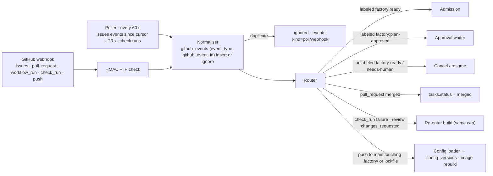

- Idempotency: every GitHub event is keyed by `(event_type, github_event_id)` in `github_events`; the poller reconstructs the same ids from the issue timeline and PR APIs, so a webhook and a poll of the same event are one row. Admission is further keyed by `tasks.task_id`.
- Migrations: forward-only SQL files `migrations/NNNN_*.sql` applied by the orchestrator at start inside one transaction per file and recorded in `schema_migrations`; one migration per PR; a factory upgrade that needs a migration applies it before any task is admitted.
- Seeding: `factory dev seed` creates a scratch repository with 10 hand-written specs (the phase 1 gate), the 10 PRD worked examples as instrument fixtures, and a 24-issue eval set in the class mix; the harness can be set to `fake` (replays recorded envelopes) so the loop runs without model calls.
- Flow back: the orchestrator writes to GitHub only through code steps under the App's installation token — branch push, PR, labels, comments; the console writes labels and `.factory/` PRs under the user's own token; a `.factory/` change reaches the orchestrator only after merge to `main`, through the `push` event, as a new `config_sha`, after its eval run passed.

## 5. Front end (Next.js console)

The task is the spine: Overview lists tasks, Task detail is one task's trace, Review findings is one task's review phase, and Approvals, Eval and Configuration are routes beside it, not separate apps. Every screen in the UI package maps to one route below; the GitHub-side screens the PRD names are templates the orchestrator renders on GitHub and are listed after the console routes (PRD §Capability 6, §Capability 1–5 Screens).

### 5.1 Route map (App Router)

| Route | Screen (UI package) | Rendering | Auth |
| --- | --- | --- | --- |
| `/` | Console-Overview (`overview`) | RSC for KPI tiles, needs-a-human and task table; client islands: `Meter`, `KillSwitchDialog`, 30 s refresh | signed in; kill-switch and controls need `write` |
| `/tasks/[taskId]` | Console-Task-Detail (`task`) | RSC for strip, phases, gate ladder, envelopes; client: `TraceTable` (SSE), `GateLadder` drawer, `ScoreBreakdown` | signed in |
| `/tasks/[taskId]/review` | Console-Review-Findings (`findings`) | RSC; client: round switcher | signed in |
| `/approvals?tab=plans\|questions\|audit` | Console-Approvals (`approvals`) | RSC queue; client: `ApprovalCard` (writes label), `AuditDecisionRow`, `RiskOverrideDialog` | signed in; approve needs `write`; governed approve needs CODEOWNER; audit needs `write` |
| `/eval` | Console-Eval-Versions (`eval`) | RSC; `EvalComparisonTable` static per run | signed in; "run eval" needs `write` |
| `/config?tab=roster\|instruments\|budgets\|paths\|installation` | Console-Configuration (`config`) | RSC from `config_versions` and GitHub Contents at `main`; client: `ProposeChangeDialog` (opens `.factory/` PR) | signed in; propose needs `write`; instruments tab notes tech-lead-only class |
| `/auth/signin`, `/auth/callback`, `/auth/signout` | — | Auth.js route handlers; GitHub App user authorisation | public → session |
| `/api/console/*` | — | BFF route handlers (section 6: proxy to orchestrator with service token + actor; GitHub writes with the user token) | per endpoint |
| `/unsupported` | — | Static notice for viewports < 1280 px and for users with no repository access | any |
| GitHub: issue template `.github/ISSUE_TEMPLATE/factory-task.yml` | Issue-Template | Rendered by GitHub from the template the installer commits | GitHub |
| GitHub: issue comments by the App | Queue-Comment, Plan-Review-Comment, Blocked-Comment, Review-Findings-Comment | Jinja templates in `orchestrator/templates/comments/`, rendered from trace rows, posted under the App | App token |
| GitHub: `specs/<issue>-<slug>.md` on `agent/<issue>` | Spec-File | Written by the planner; shown by GitHub and by Console-Approvals | GitHub |
| GitHub: PR description | PR-Body | `templates/pr_body.md.j2` rendered from `gate_results`, `phases`, `envelopes` — never agent text | App token |
| Trace-Query | — | `factory trace --task T --phase P` CLI and the same SQL views the console uses; no screen | VM shell |

Responsive rule: the console is desktop-only by PRD; a viewport narrower than 1280 px redirects to `/unsupported` with the message "Factory Console needs a window at least 1280 px wide"; no route has a mobile layout.

### 5.2 Component tree and data fetching

| Layer | Server components | Client components |
| --- | --- | --- |
| Chrome | `Shell` (header: installation, nav with Approvals badge, `FACTORY_ENABLED` flag, login pill), `AnnotationRail` (dev only, off in production), `Freshness` stamp | `ThemeRoot` (light/dark from `prefers-color-scheme`, no toggle in v1), `KeyboardMap`, `NavBadge` (polls `/needs-human/count` every 30 s) |
| Overview | `KpiRow` (5 × `KPITile` data), `NeedsHumanTable`, `RunningQueuedTable`, `SpendByTask`, `IndicatorsPanel` (leading indicators, collapsed by default) | `KPITile`, `Chip`, `Meter` (daily spend), `KillSwitchDialog`, `StuckFlag` |
| Task detail | `TaskStrip`, `PhaseTimeline`, `GateLadder` (rows), `RepairRounds`, `EnvelopeViewer` (tabs), `ChainFooter` | `TraceTable` (SSE tail, pause/resume, virtualised), `EvidenceDrawer`, `ScoreBreakdown` (risk), `Meter` (task budget), `CopyJson` |
| Review findings | `ReviewHeader`, `AcTable`, `FindingsList` | `RoundSwitcher`, `ScoreBreakdown` (review), `Chip` |
| Approvals | `PlanQueue`, `SpecView` (sections, AC→holdout table with existence checks), `QuestionsTable`, `AuditStrata`, `AuditTable` | `ApprovalCard` (writes label under the user), `RiskOverrideDialog`, `AuditDecisionRow`, `Chip` |
| Eval and versions | `EvalSetSummary`, `RunsByVersion`, `BlockedChange`, `InstallDryRun` | `EvalComparisonTable`, `RunEvalButton` |
| Configuration | `OpenChanges` (`ConfigChangeCard` data), `RosterTable`, `InstrumentTables`, `BudgetsTable`, `ProtectedPathsTable`, `InstallationPanel` | `ProposeChangeDialog`, `ConfigChangeCard` |

- Cache keying and invalidation: orchestrator reads are `fetch` with `cache: 'no-store'` for tasks, events, approvals and KPIs (the trace is live); configuration and eval reads are tagged `config:<config_sha>` and `eval:<run_id>` and revalidated on a `push`/eval-complete event the BFF receives from the orchestrator's `/changes` SSE; GitHub Contents reads for `/config` are cached 60 s per `main` sha.
- Pre-rendering: nothing is statically pre-rendered except `/unsupported` and the keyboard map; every other route renders per request on the server from the API.
- Streaming transport: the live tail is Server-Sent Events from `GET /api/v1/tasks/{id}/events/stream?after=<seq>`; the orchestrator pushes rows from its in-process writer hook so a row appears ≤ 5 s after the write (p95 ≤ 2 s measured); on disconnect the client resumes from its last `seq`. WebSocket was rejected because the tail is one-way and needs no input channel; polling at 4 s is the fallback when SSE is blocked by a proxy.
- i18n: the UI is English (PRD §Non-functional · Languages); a blocked task's question is rendered verbatim in the issue's language with `lang="pt-BR"` or `lang="en"` on the cell; there is no catalogue and no CI overflow check, because no string is translated.
- Accessibility per component (design package Set 2): `Chip` is `role="img"` with `aria-label` "Task state: blocked" and always carries glyph + text; `GateLadder` is `role="list"` with position announced; `Meter` is `role="meter"` with `aria-valuetext`; `ApprovalCard` and `KillSwitchDialog` are real buttons and a focus-trapped dialog with the Reason field required before Enter confirms; focus ring 2 px accent, 2 px offset; `prefers-reduced-motion` disables the tail tint and pulse; targets ≥ 24 × 24 px.
- Keyboard map: `1`–`6` go to the six screens; `j` `k` move between rows; `Enter` opens the focused task, gate or approval; `a` focuses the approval button on an open plan; `Esc` closes the drawer or dialog; `p` pauses and resumes the tail; `?` shows this map; the kill-switch is reachable by Tab from the Overview header and confirms only with a filled Reason.

### 5.3 State

| State | Lives in |
| --- | --- |
| Screen, task id, approvals tab, config tab, eval run, selected gate attempt | URL |
| Tasks, phases, events, gate results, approvals, KPIs, eval runs | Orchestrator API (trace.db) via server fetch; no client store |
| Configuration files | GitHub `main` via Contents API, mirrored by `config_versions` |
| Session, user token (encrypted) | Console `sessions` SQLite file, separate from `trace.db` |
| Tail paused flag, drawer open, collapsed Indicators panel, theme override | Client memory; theme override and collapsed state also in `localStorage`, best effort |
| Draft of a proposed configuration change | Client memory until the PR is opened; kept in `sessionStorage` on a 422 so the user can retry |

### 5.4 Performance budgets (PRD §Non-functional · Performance)

| Budget | Mechanism |
| --- | --- |
| Overview ≤ 2 s p95 with 1,000 tasks | KPIs read from `kpi_daily` (materialised nightly and on merge events), not computed per request; task table is `SELECT … FROM tasks WHERE status IN ('queued','running','blocked','pr_open') ORDER BY created_at` on `tasks_status`; `v_needs_human` indexed; one API round trip per panel, run in parallel |
| Task detail ≤ 2 s p95 with 10,000 trace rows | Events paged by `seq` cursor, 200 rows per page, `events_phase` index; the first paint shows the last page and the virtualised list fetches earlier pages on scroll; envelopes and gate evidence loaded by phase on demand |
| Live tail ≤ 5 s behind the write | In-process publish on `events` insert → SSE flush; SQLite WAL readers never block the writer; 4 s poll fallback |
| Admission ≤ 2 min p95 after the label event | Webhook path: HMAC check, `github_events` insert and `tasks` insert in one request (< 500 ms); poller interval 60 s bounds the no-webhook case at ≤ 2 min p95 and ≤ 5 min p99 |
| Phase timeouts 30 / 120 / 45 min | Per-process watchdog from `processes.started_at` + `phases.timeout_s`; SIGTERM to the process group or `docker kill`; 10 s grace then SIGKILL |
| `risk:low` task ≤ 6 h to `pr_open` or `blocked` at p50 | Concurrency N keeps a task on one slot without pre-emption; the queue is label-ordered; per-phase caps bound the worst case at 30 + 4 × 120 + 2 × 45 + full-suite time |

## 6. Back end

REST with an OpenAPI 3.1 contract generated from the orchestrator's pydantic models (the same models validate envelopes), served by FastAPI at `http://orchestrator:8080/api/v1` on the compose network; long-running work is the orchestrator's own loop, not request threads; every endpoint passes the in-code authorisation decision table before touching the database, with the acting login taken from `X-Factory-Actor` only when the request carries the console's service token, and from the HMAC-verified webhook otherwise.

### 6.1 Endpoint catalogue (PRD §Capability 5–6)

| Method · path | Auth · role | Request → response | Rate limit | Idempotency | Errors |
| --- | --- | --- | --- | --- | --- |
| `GET /healthz` | none (compose network) | → `{status, factory_enabled, db_ok, proxy_ok, last_poll_at}` | — | — | 503 |
| `GET /installation` | read | → `installation` minus secrets, plus `config_sha`, `factory_version` | 300/min/login | — | — |
| `GET /tasks?status=&limit=&cursor=` | read | → `{items: Task[], next}` | 300/min/login | — | 400 |
| `GET /tasks/{task_id}` | read | → task, runs, phases, approvals, budget, links | 300/min/login | — | 404 |
| `GET /tasks/{task_id}/events?after=&kind=&limit=` | read | → `{items: Event[], next}` (200 max) | 300/min/login | — | 404 |
| `GET /tasks/{task_id}/events/stream?after=` (SSE) | read | → `event: row` per insert; `event: ping` every 15 s | 5 streams/login | resume by `seq` | 404, close on sign-out |
| `GET /tasks/{task_id}/envelopes` · `GET /tasks/{task_id}/gates` | read | → envelopes · gate results with `output_tail` | 300/min/login | — | 404 |
| `GET /tasks/{task_id}/review?round=` | read | → reviewer envelope, scored findings, conformance, verdict, dismissed | 300/min/login | — | 404, 409 no review yet |
| `GET /tasks/{task_id}/export` | write | → JSONL + signed trailer (4.3) | 10/hour/login | — | 404 |
| `POST /tasks/{task_id}/budget` | write | `{budget_usd, reason}` → `{old, new, event_seq}`; new ≤ 2 × current, once per task | 10/min/login | `Idempotency-Key` | 403, 409 already raised, 422 > 2× |
| `POST /tasks/{task_id}/resume` | write | `{reason}` → `{status}`; applies the 7.8 resume rule for `blocked_reason` | 10/min/login | `Idempotency-Key` | 403, 409 not resumable |
| `POST /tasks/{task_id}/risk-override` | write | `{risk: 'risk:high'\|'risk:governed', reason}` → `{approval_id}` | 10/min/login | `Idempotency-Key` | 403, 409 after `pr_open` |
| `GET /approvals/plans` · `GET /approvals/questions` | read | → queues with spec, AC→holdout map, risk breakdown · open questions with language | 300/min/login | — | — |
| `GET /audit/queue?month=` · `POST /audit/{task_id}` | write | → `v_audit_queue` · `{decision, reason}` → `{event_seq}` | 60/min/login | one decision per task per month (`UNIQUE`) | 403, 409 decided |
| `GET /kpis?window=30d` · `GET /indicators` | read | → five headline metrics with numerator, denominator, target · leading indicators with thresholds | 300/min/login | — | — |
| `GET /needs-human/count` | read | → `{plans, questions, decisions, budget}` | 600/min/login | — | — |
| `POST /controls/concurrency` | write | `{n, reason}` → `{old, new, event_seq}` (1–10) | 10/min/login | `Idempotency-Key` | 403, 422 |
| `POST /controls/kill-switch` | write | `{enabled: 0\|1, reason}` → `{live_processes, event_seq}`; `0` fans out SIGTERM ≤ 60 s | 1/min/login | `Idempotency-Key` | 403, 409 already in state |
| `POST /controls/admissions` | write | `{paused: 0\|1, reason}` → `{event_seq}`; also clears an open `incident` when `paused: 0` carries `clear_incident: <seq>` | 10/min/login | `Idempotency-Key` | 403, 409 already in state |
| `GET /eval/sets` · `GET /eval/runs` · `GET /eval/runs/{id}` | read | → sets, runs by version with per-class rates and baseline delta | 300/min/login | — | 404 |
| `POST /eval/runs` | write | `{set_id, trigger: 'manual'}` → `{run_id}`; replays on `eval/scratch` | 2/hour | `Idempotency-Key` | 403, 409 run in progress, 422 set < 20 items |
| `GET /config` · `GET /config/history` | read | → current `config_versions` row (roster, instruments, protected paths, quality commands) · prior shas with eval verdicts | 300/min/login | — | — |
| `GET /changes` (SSE) | service token | → `config_loaded`, `eval_complete`, `task_changed` notices for cache invalidation | 1 stream per console | — | — |
| `POST /webhooks/github` | HMAC + GitHub IP | GitHub event → 202; normalised into `github_events` | 600/min | `(event_type, github_event_id)` | 401 bad signature, 403 IP |
| Console BFF: `POST /api/console/labels` | session, write | `{issue, add: 'factory:plan-approved' \| remove: 'factory:ready' \| remove: 'factory:needs-human'}` → GitHub response; written with the user's token | 30/min/login | by GitHub (label set is idempotent) | 401, 403 (GitHub refused), 409 spec sha changed |
| Console BFF: `POST /api/console/config-pr` | session, write | `{file, edits[], reason}` → `{pr_url, branch}`; branch `factory-config/<login>/<ts>`, commit and PR under the user's token | 10/day/login | by branch name | 401, 403, 422 branch exists |

Error body everywhere: `{code, message, detail?, traceId}`; messages are declarative and name the fix ("GitHub refused the label write (403): your token lacks write access on acme/atlas-api").

### 6.2 Authorisation model (PRD §Capability 6, §Non-functional · Security)

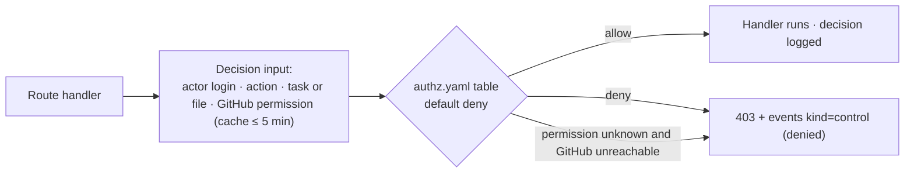

| Subject | May |
| --- | --- |
| Signed-in user with `read` on the repository | Read every screen and endpoint marked `read`; may never see secrets, user tokens or another user's session |
| Signed-in user with `write`, `maintain` or `admin` | read + write `factory:plan-approved` for `risk:high` plans; remove `factory:ready` (cancel) and `factory:needs-human` (resume); risk override; budget raise; concurrency; pause and resume admissions and clear an incident; kill-switch off and on; audit decisions; propose `.factory/` PRs; run eval; export |
| CODEOWNER of the governed path (per `CODEOWNERS` at `main`) | write + `factory:plan-approved` on a `risk:governed` task whose `governed_path` they own; the label from a non-owner is recorded and ignored by the waiter |
| Console service identity | Read the API and `/changes` on behalf of a verified actor; may never write without `X-Factory-Actor`; may never read `trace.db` directly |
| Orchestrator (GitHub App installation token) | Push `agent/*` and `eval/scratch` branches; open PRs; write labels and comments; read Contents; may never push to `main`, approve a PR or merge |
| Agents `planner`, `builder`, `reviewer` (task container) | Read the mounted worktree and the inputs section 8 lists; write only inside the roster's `writes` boundary (planner `specs/`, builder everything except protected paths, reviewer nothing); may never reach GitHub, `trace.db`, the holdout checkout or any host but the model proxy |
| Model proxy | Forward to the two configured provider hosts with vendor keys; may never read the repository or the trace |

Who may do what is policy, not scattered code: `authz.yaml` in the factory repository is a decision table `(permission, action, condition) → allow` generated into `authz.py` and `authz.ts` at build; it is versioned with the factory tag, and a table that fails to parse at start aborts start-up rather than defaulting open. The GitHub permission check is `GET /repos/{owner}/{repo}/collaborators/{login}/permission` cached 5 minutes; an expired cache with GitHub unreachable denies writes and shows the console's "GitHub · unreachable" banner.

### 6.3 Budget enforcement (PRD §Capability 5, §Non-functional · Cost control)

- The per-phase cap is enforced before the call at the model proxy: each `agent` phase gets a LiteLLM virtual key with `max_budget = phase_cap_usd` and `duration = timeout_s`; the proxy refuses the request at the cap with 429, which the harness surfaces as a failed call and the orchestrator records as `budget_stop`. The proxy cap is the line that applies to both harnesses; `--max-budget-usd` is passed to Claude Code as an additional line.
- The per-task budget and the daily cap are enforced by the orchestrator between phases (a phase does not start if `spent_usd + phase_cap_usd > budget_usd` or if today's spend plus the cap exceeds `daily_cap_usd`) and by the watchdog during a phase, which reads the key's spend from the proxy every 10 s and sends SIGTERM when `spent_usd` reaches `budget_usd`; the stop lands ≤ 60 s after the breach.
- Who receives no key: code phases, the reviewer's gate runner, the full-suite runner, the console and the orchestrator itself; only an `agent` phase's container holds a virtual key, and it is revoked at `phase_end`.
- The meter: at `phase_end` the orchestrator reads the key's final spend and tokens from the proxy and writes them to `phases` and the `agent_end` event; `tasks.spent_usd` and `runs.total_cost_usd` are sums over phases. Console-Task-Detail's task `Meter`, Overview's "Spend today" `Meter` and the PR body read these columns.
- At the cap: the phase is killed, the task becomes `blocked` with `blocked_reason = 'budget'`, `factory:budget` is applied and a comment posts the spend; a write-access user may raise the task budget once (≤ 2×) from the console and resume. The daily cap stops every running phase and holds the queue until the day rolls over.

### 6.4 Rate limits and the throttle rule (PRD §Capability 1, 3, 4, §Risks · Review bottleneck)

| Rule | Value | Enforced at |
| --- | --- | --- |
| Webhook deliveries | 600/min | Caddy public listener |
| Console API reads | 300/min/login | FastAPI middleware (token bucket in memory) |
| SSE streams | 5 per login, 1 `/changes` per console | FastAPI |
| Control actions (budget, concurrency, resume, risk override) | 10/min/login | FastAPI |
| Kill-switch | 1/min/login | FastAPI |
| Label writes by a user | 30/min/login | Console BFF |
| `.factory/` PRs | 10/day/login | Console BFF |
| GitHub API from the orchestrator | ≤ 30 req/min polling; label and comment writes ≤ 100/h per task | Poller scheduler; writer |
| Concurrency | N running tasks, default 3, 1–10 | Scheduler |
| Repair and revision caps | 3 repairs per build attempt; 2 revisions per review; 1 full-suite repair; ≤ 2 spec-gate corrections; 1 envelope re-prompt | State machine |
| Infra retries | API 5xx and 429 from the proxy: 3 retries with backoff 5 s, 20 s, 60 s; not counted against repair caps | Harness adapter |
| Review-backlog throttle | Merge rate over 30 days < 70% → `admissions_paused = 1` until open factory PRs < 5; new `factory:ready` labels wait in `queued` with a comment naming the rule | Admission |
| Protected-path incident | A protected-path change reaching a PR (CI diff check) → `admissions_paused = 1` and `events kind=incident`; cleared by an operator control with reason | CI observer |
| Stuck run | `processes.last_event_at` older than 15 min while running → Overview flag, Slack notice; phase timeout still governs the kill | Watchdog |

## 7. Sequence diagrams

Eight flows, each with its failure branches. The loop in every agent phase is plan · act · observe · verify · repair with the cap written into the message; every gate is deterministic code that runs after the agent finishes and before anything reaches GitHub; every flow writes `events` (PRD §Capability 1–6).

### 7.1 Admission (PRD §Capability 1)

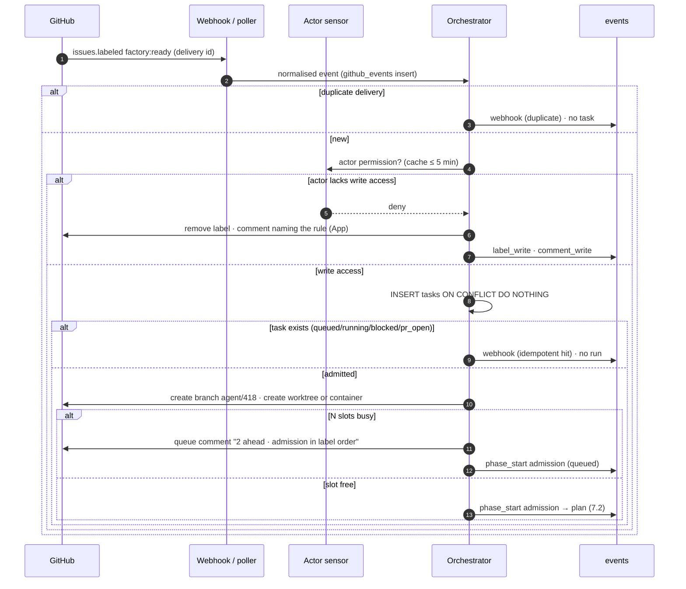

A label from the wrong actor or a repeated label never creates a run, and GitHub changes only after the `tasks` row exists; the human sees either a queue comment or nothing until the plan phase posts.

### 7.2 Plan, spec gate, risk and approval (PRD §Capability 2, §Task risk classification)

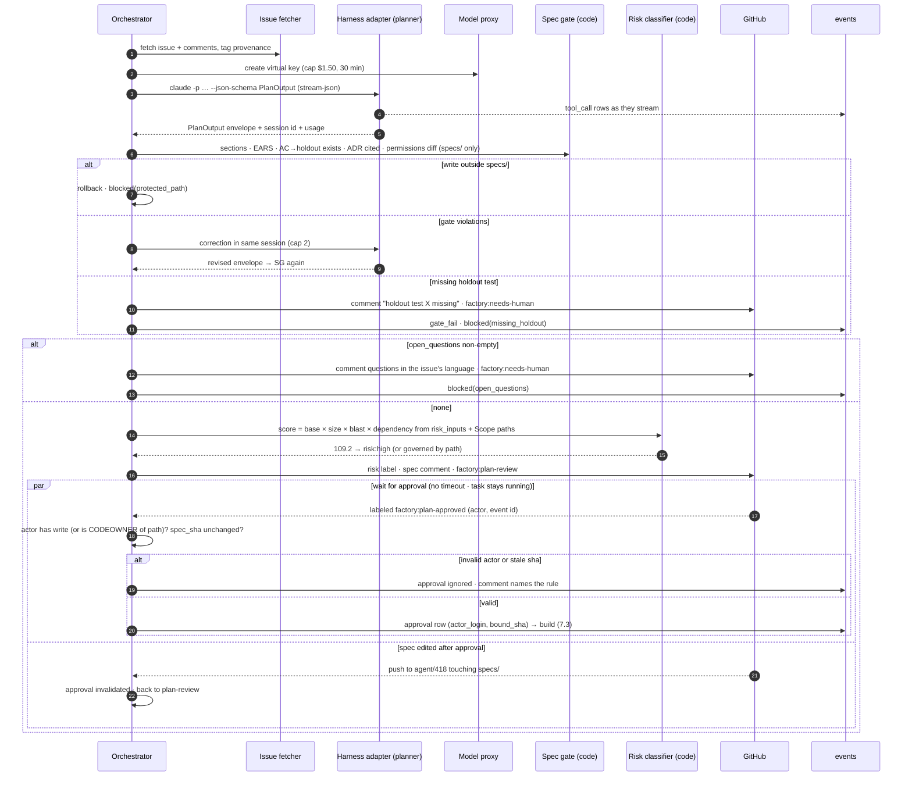

The score and the class come from code reading `risk.yaml`, never from the planner, and the approval the build waits for is a GitHub label whose actor and event id the orchestrator verified; the console's approval card writes that label and nothing else.

### 7.3 Build and code gates (PRD §Capability 3)

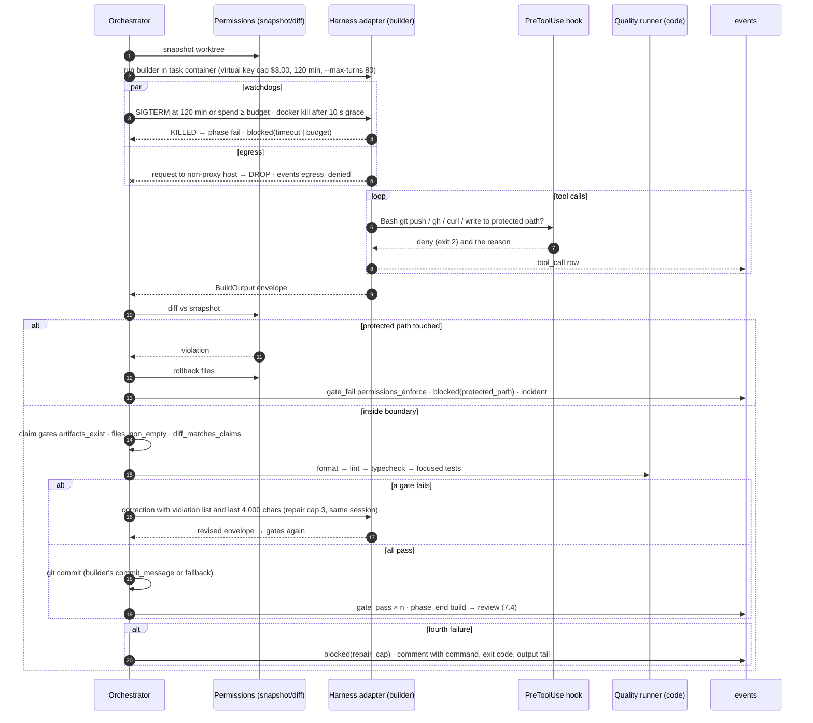

The builder never commits, pushes or sees the issue thread; a protected-path touch is rolled back and ends the task rather than being offered as a correction, and the three repairs happen inside one session so the correction costs one message.

### 7.4 Independent review and verdict (PRD §Capability 4, §Review verdict policy)

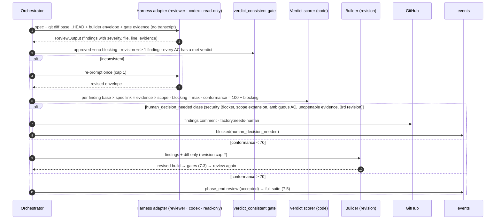

The reviewer sees the diff and the spec, never the builder's reasoning, and emits findings, never a verdict: the verdict is arithmetic in code over `review-policy.yaml`, so the PRD's worked examples are unit tests and a Non-goals finding scores 0 by construction.

### 7.5 Full suite, delivery, CI re-entry and merge (PRD §Capability 5)

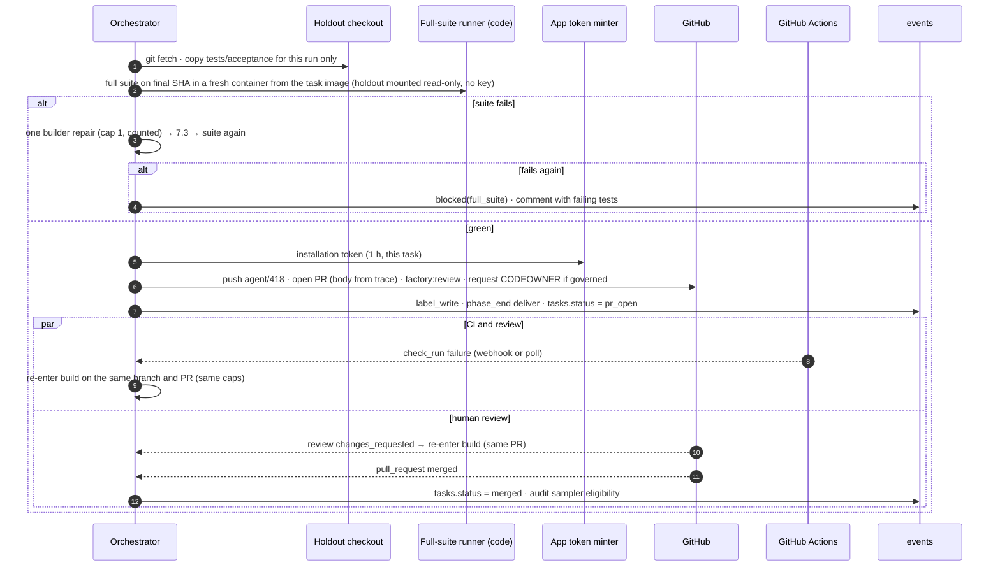

The holdout tests enter the pipeline only here, mounted read-only into a fresh container the builder never ran in; the PR body is rendered from `gate_results` and `phases`, so what the reviewer on GitHub reads is evidence the agent could not author; a second PR for the same task is impossible because re-entry reuses `tasks.pr_number`.

### 7.6 Console approval, audit and kill-switch (PRD §Capability 6)

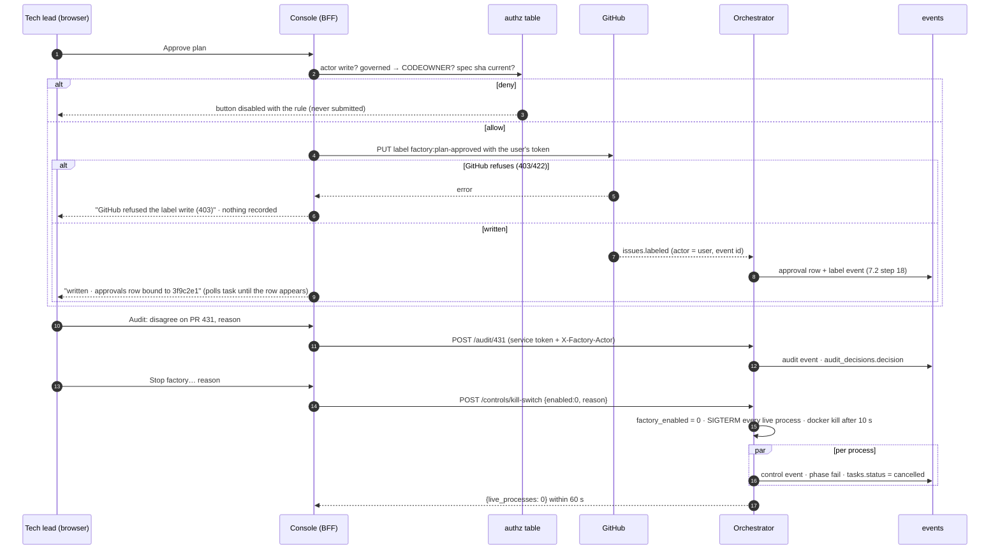

The console never holds an approval: the only record is the GitHub label event and the `approvals` row the orchestrator derives from it, so a console outage cannot approve, block or merge anything; every control action is one `events` row carrying the login and the reason.

### 7.7 Integrations (PRD §Capability 6 sign-in, §Capability 5 budgets, §Scope · Phase 4)

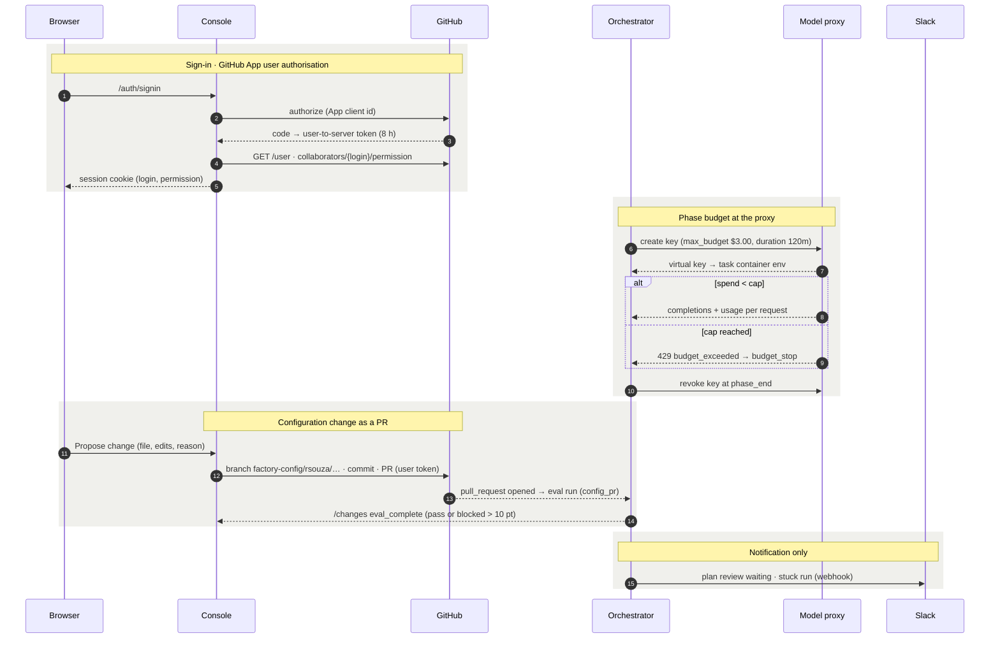

Each integration has one owner: identity and attribution are GitHub's, budgets are the proxy's, state is the orchestrator's, notifications are Slack's and never an approval. Webhook and poll reconciliation is section 4.5's diagram.

### 7.8 Restart and resume from blocked (PRD §Capability 5 · Restart, §Capability 3, 4 · blocked)

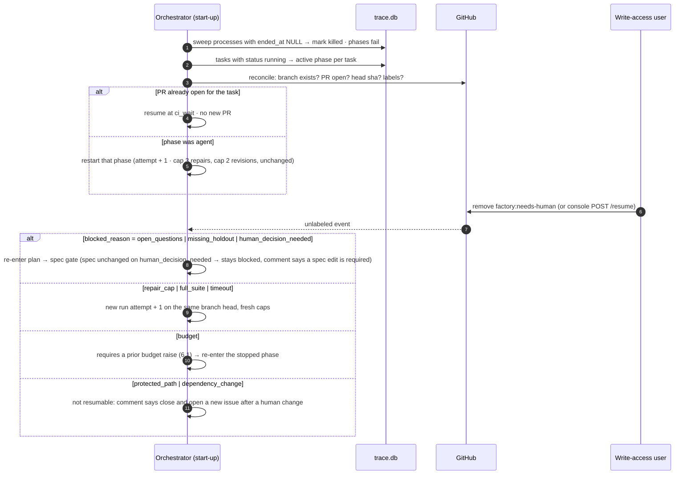

Resume never replays a side effect: the reconciliation reads GitHub before acting, so five restarts open zero duplicate PRs, and a block whose cause was a human omission (holdout, question, decision) resumes only after a human changed the thing that caused it.

## 8. AI agent specifications

Three agents — planner, builder, reviewer — each a versioned guide with a byte-stable prefix, a structured output schema validated by code, sensors before and after, and a calibration procedure against the eval set and the human audit (PRD §Capability 2–4, §Metrics). No agent computes a score; the two instruments run in code.

|  | Planner | Builder | Reviewer |
| --- | --- | --- | --- |
| Model tier | Frontier (Anthropic, via Claude Code); thinking high; pinned model id in `roster.yaml`, recorded on `phases.model_id` | Frontier (Anthropic, via Claude Code) in phases 1–3; may move one tier down from phase 4 only when an eval run shows ≤ 5 points drop | Frontier (OpenAI, via Codex `exec --sandbox read-only`); a different vendor from the builder, enforced by `config_versions` |
| Guide | `prompts/planner/{system,user}.md` in the factory repo + `.factory/prompts/planner/` overrides; version = factory tag + `config_sha` | `prompts/builder/{system,user}.md` + overrides | `prompts/reviewer/{system,user}.md` + overrides |
| Prefix order (byte-stable, cached) | 1 system guide · 2 spec template and gate rules · 3 `CLAUDE.md`/`AGENTS.md` · 4 ADR index · 5 provenance-tagged issue (data) | 1 system guide · 2 write boundary and command names · 3 spec · 4 previous `VerifyOutput` (repair only, ≤ 4,000 chars) · 5 reviewer findings (revision only) | 1 system guide · 2 `review-policy.yaml` severities and examples · 3 spec · 4 builder envelope · 5 gate evidence · 6 `git diff base...HEAD` |
| May read | Repository (read-only), `docs/adr/`, the tagged issue text | The worktree inside the write boundary, test/lint/typecheck command names, the spec | The worktree read-only, the spec, the diff, the builder envelope, gate evidence |
| May never read | Builder or reviewer outputs; any token or env beyond its key; the holdout checkout | The issue thread; planner or reviewer transcripts; `tests/acceptance/`; any GitHub credential | The builder's transcript or reasoning; the issue thread; user identity; the holdout checkout |
| Output schema | `PlanOutput {status, summary, artifacts[], notes_for_next_agent, risk_inputs{tiers_touched[], est_lines, new_dependencies[], modules[]}, open_questions[]}` | `BuildOutput {status, summary, changed_files[], tests_added[], commit_message, notes_for_next_agent}` | `ReviewOutput {approved, verdict, findings[{requirement_id, met, severity, file, line, problem, impact, correction, evidence}], blocking[]}` |
| Sensors before | Issue fetched by the provenance script; template headings present; `FACTORY_ENABLED = 1`; budget headroom | Spec gate passed; risk approval present when required; permissions snapshot; virtual key issued | Build gates passed; commit exists; diff non-empty |
| Sensors after | `envelope_schema`; `permissions_enforce` (specs/ only); `spec_sections`, `spec_ears`, `spec_ac_holdout_map`, `spec_adr_cited`; risk score recomputed in code | `envelope_schema`; `permissions_enforce`; `artifacts_exist`; `files_non_empty`; `diff_matches_claims`; `format`, `lint`, `typecheck`, `focused_tests` | `envelope_schema`; `verdict_consistent`; score, blocking and conformance recomputed in code from `review-policy.yaml`; Non-goals dismissal by code |
| Cap | 1 call + 2 corrections; 30 min; phase cap from roster ($1.50 default) | 1 build + 3 repairs per attempt; 120 min per phase; `--max-turns 80`; phase cap ($3.00 default) | 1 call + 1 consistency re-prompt per round; 2 revision rounds; 45 min; phase cap ($1.50 default) |

Guides are files: factory defaults in the factory repository under `prompts/`, per-installation overrides under the product repository's `.factory/prompts/`, both protected paths; an override ships only through a `.factory/` PR whose eval run passed, and the factory default only through a factory tag. Every `agent_start` event logs the guide sha, the harness version read from the binary, the pinned model id and the virtual key id, so a prompt can be reproduced from the trace.

### 8.1 Calibration (PRD §Metrics, §Review verdict policy, §Task risk classification)

| Agent | Reference set | Metric | Gate | Retirement |
| --- | --- | --- | --- | --- |
| Planner | The eval set (≥ 20 issues, class mix of the last 90 days) | Spec-gate pass rate on first call; share of eval items whose spec led to a passing run | Eval pass rate ≥ 60% overall; a prompt change that drops it > 10 points is blocked | A spec-gate rule that fails > 30% of first calls for 2 weeks is reviewed with the template |
| Builder | The eval set | Pass rate overall and per class; mean repair rounds | ≥ 60% overall; a class < 40% is not promoted to a looser gate; repair rounds mean ≤ 1.5 | A model tier that drops pass rate > 5 points versus the previous tier is reverted |
| Reviewer | Tech lead's monthly audit (every `risk:high` and `risk:governed` PR; 10% of `risk:low`) | Human-audit disagreement on the low-risk stratum; override rate per severity tier | Disagreement ≤ 5%; a tier with > 20% override triggers a `review-policy.yaml` recalibration PR | A tier or factor overridden > 20% in 2 consecutive months is recalibrated before the next month's audit |
| Risk classifier (code, calibrated against tech-lead overrides) | `approvals` rows with `gate = 'risk_override'` | Override rate per tier | > 20% on a tier in a month triggers a `risk.yaml` recalibration PR | Same rule as the reviewer |

The audit queue is built by code (`audit_decisions.sampled`), not chosen by the tech lead, so the sample cannot drift toward easy PRs; there are no seeded items in v1 because the queue measures the reviewer, not the tech lead.

## 9. Observability and audit

The trace database is the observability store and the audit record: every model-backed phase writes an `agent_start`/`agent_end` pair whose attributes follow the OpenTelemetry GenAI semantic conventions by name (`gen_ai.request.model`, `gen_ai.usage.input_tokens`, `gen_ai.usage.output_tokens`), every tool call is one row, and every human action is one row with a login (PRD §Non-functional · Auditability, §Capability 5). An optional OTLP exporter mirrors `agent_end` and `tool_call` rows when `FACTORY_OTLP_ENDPOINT` is set; nothing depends on it.

| Event | Span attributes | Stored in |
| --- | --- | --- |
| Agent phase (`agent_start`/`agent_end`) | role, harness, harness version, `gen_ai.request.model`, guide sha, session id, virtual key id, `gen_ai.usage.input_tokens`, `output_tokens`, cache read/write tokens, cost USD, duration, attempt | `phases` columns + `events` |
| Tool call | `tool`, `tool_call_id`, `args` (scanned), `result_snippet` (≤ 1,000 chars, scanned), `ok`, `duration_ms`, `agent`, `started_at`, `ended_at` | `events.payload_json` |
| Gate | gate name, passed, `gate_results.id`, attempt, command, exit code | `gate_results` + `events gate_pass/gate_fail` |
| GitHub write | object (issue, PR, branch), label or comment id, identity used (App or login) | `events label_write/comment_write` |
| Approval | label event id, actor login, bound sha, governed path, codeowner | `approvals` + `events approval` |
| Control | action, login, reason, old value, new value | `events control` |
| Audit | PR, stratum, decision, reason, login | `audit_decisions` + `events audit` |
| Egress denial | container id, destination, timestamp | `events egress_denied` |
| Budget stop | phase, spend, cap breached (phase, task, daily) | `events budget_stop` |
| Incident | kind (protected path reached PR, scanner hit, egress to registry), cleared by, reason | `events incident` |
| Eval run | trigger, factory version, config sha, pass rate overall and per class, delta, blocked | `eval_runs`, `eval_results` |

Dashboards, one per PRD headline metric and one for leading indicators — all of them panels of the console reading `kpi_daily` and the views, refreshed daily and on merge:

| Dashboard | Series |
| --- | --- |
| Factory-authored merge share | merged PRs from `agent/*` / all merged PRs, 30-day window, daily points |
| Factory PR merge rate | `tasks.status = merged` / PRs opened, 30-day window |
| Unattended rate | tasks reaching `pr_open` or `blocked` with 0 `engineer`-kind events / tasks admitted |
| Human-audit disagreement | disagree / sampled on the `risk:low` stratum; the high and governed strata as separate series, never pooled; sample size beside the rate |
| Cost per merged PR | Σ `runs.total_cost_usd` per merged task; 30-day median; count over budget |
| Leading indicators (Overview › Indicators panel) | repair rounds per task (1.5 / 2.5 lines); escalation rate (20 / 35); gate-fail distribution (30% line per gate); review minutes per PR (20 / 40); eval pass rate per class (60 overall, 40 per class); protected-path attempts and changes reaching a PR; stuck runs per week; reviewer override per tier (20% line); second-installation eval gap (10-point line) |

Not collected, by design (PRD §What is not measured): lines of code per agent, PRs per engineer as a ranking, tokens per task as a target, and velocity in story points — there is no view keyed by login other than the audit queue, the KPI views have no per-user grouping, and no table stores line counts.

Audit export: section 4.3's signed JSONL per task from `GET /tasks/{task_id}/export`, itself recorded as an `export` event; a whole-installation export is `factory export --from SEQ --to SEQ` on the VM.

## 10. Security and threat model

The twelve risks the PRD names plus one this document adds (secret leakage into the trace or a prompt), each with the control that enforces it, where it is detected, and what remains (PRD §Risks, §Non-functional · Security; arch §8–§9).

| Attack | Control | Source | Detection | Residual risk |
| --- | --- | --- | --- | --- |
| Test gaming: the builder edits tests or special-cases inputs | Holdout tests live in a checkout outside the builder's container and enter only the full-suite phase; `tests/acceptance/` protected by hook and post-run diff with rollback; reviewer scores special-casing as a Blocker; tech lead audits every high-risk and governed PR and 10% of low-risk | arch §8; ImpossibleBench | `permissions_enforce` failures; reviewer findings; audit disagreement | Special-casing that mirrors the visible unit tests but not the holdout passes until the holdout runs; a holdout written too close to the unit tests weakens the check |
| Placeholder gates that exit 0 | Startup self-test runs every configured command against a known-failing fixture and refuses to start on exit 0; `quality.py` and `.factory/` protected | arch §8 | Self-test log; `v_gate_fail_distribution` with 0 failures for 2 weeks triggers inspection | A command that fails the fixture but ignores part of the suite (wrong glob) passes the self-test |
| Prompt injection through issue text or repository content | Issue text is data with provenance tags, never in a system prompt; the builder sees only the spec; task container has no secrets but a phase-scoped virtual key and no egress but the proxy; hooks deny `gh`, `git push`, `curl`, `wget`; dependency changes block for a human | arch §9; Willison's lethal trifecta | Egress denials; hook denials in `tool_call` rows; scanner hits | An injected instruction can still waste the phase budget or steer the spec; the spec gate and the human plan review are the remaining checks |
| Reviewer rubber-stamps or hallucinates findings | Fresh session, other vendor, no transcript; `verdict_consistent`; a finding without `file:line` scores 0; code computes the verdict | arch §8 | Override rate per tier; audit disagreement | A reviewer that misses a real defect produces no finding to score; the holdout and the human review on GitHub catch what it misses |
| Review bottleneck and PR floods | N = 3; review-backlog throttle pauses admissions when merge rate < 70% until open factory PRs < 5; review minutes per PR indicator | PRD §Risks | `admissions_paused` events; indicator | Humans may still skim; the audit sample is the only measure of that |
| Cost blow-up | Virtual key `max_budget` per phase at the proxy; `--max-turns`; task budget and daily cap enforced between phases and by the 10 s watchdog; SIGTERM ≤ 60 s | arch §10 | `budget_stop` events; cost per merged PR | Up to one watchdog interval (10 s) of spend past a cap; a proxy outage pauses all agent phases (fail-closed) |
| Hung agent | Per-phase timeout with process-group SIGTERM then SIGKILL; `processes.last_event_at` stuck flag at 15 min | arch §7 | Stuck-run indicator; Slack | A harness that emits heartbeat tool calls while making no progress runs to its timeout |
| Harness drift | Harness version from the binary on every phase row; eval run on every harness upgrade blocks on a > 10-point drop; adapter isolates flag names | PRD §Risks | Eval delta; adapter parse errors as `error` events | A silent output-format change that still parses can degrade envelopes until the eval catches it |
| Weak specs | Spec gate (sections, EARS, AC→holdout, ADR); open questions block; repair-rounds indicator | arch §6 | Repair rounds > 2.5 for a week | A spec that passes the gate but mis-states the outcome produces a correct build of the wrong thing; the plan review catches it only for `risk:high` |
| Duplicate PRs or comments after a crash | `tasks.task_id` key; `github_events` idempotency; start-up reconciliation reads GitHub before acting; `pr_number` reused on re-entry | arch §7 | Phase 3 gate (0 duplicates in 5 restarts); weekly reconciliation query | A crash between PR creation and the `pr_number` write can leave one PR the reconciliation must adopt by branch name |
| Client installation leaks source code or credentials | Single-tenant VM; App token per task in orchestrator memory only; vendor keys only in the proxy; egress only to the chosen vendors; `trace.db` on the installation | PRD §Risks | Secret scanner count; egress denials | Prompts and diffs reach the chosen vendors under their retention terms; the installation chooses the vendors |
| The console drifts into a second source of truth | Console writes only labels (user token) and `events` (via the API); approvals derived from label events; configuration changes as PRs; weekly reconciliation query lists any task whose console state differs from GitHub and opens an incident | PRD §Risks | `incident` events; reconciliation report | A GitHub label removed by hand without the orchestrator seeing it (webhook lost, poll lag ≤ 60 s) leaves the console stale for one poll interval |
| Secret leakage into the trace or a prompt | Allow-listed prompt builder; explicit container environment; gitleaks in CI and at ingestion with redaction | PRD §Non-functional · Security | Scanner count must be zero; hit opens an incident | A secret pasted into an issue reaches the planner as data and is redacted only in the trace, not at the vendor |

Fail-closed everywhere a decision is made: the authorisation table denies when the permission is unknown and GitHub is unreachable; the webhook receiver discards a delivery whose signature or source IP fails; the model proxy unreachable means no agent phase starts and a running one fails on its next call; `FACTORY_ENABLED` unreadable (database locked beyond `busy_timeout`) is treated as 0 and no phase starts; a `config_versions` row that fails its checks is not loaded and the previous `config_sha` stays active with an `incident` event; a harness binary whose version cannot be read refuses to run.

## 11. Testing, CI/CD and environments

The eval set is the regression gate: no factory tag, prompt, roster, gate, instrument or harness change ships unless the ≥ 20-issue replay loses no more than 10 points against the merged baseline (PRD §Capability 5, §Non-functional · Content integrity).

| Level | What | Tooling | Gate |
| --- | --- | --- | --- |
| Unit | Risk and verdict arithmetic with the PRD's 10 worked examples as fixtures (40 → low; 109.2 → high; 30 → low; 60 → high; 56 → 44 → revision; 6 → 94 → accepted; 100 → 0; Non-goals → 0); state-machine transitions and caps; spec gate rules; permissions diff; hash chain; daily-cap trigger; audit sampler | pytest, Hypothesis for the chain and sampler | 100% of instrument branches; every worked example exact |
| Contract | Every `/api/v1` endpoint and both BFF routes against the OpenAPI schema; envelope schemas against recorded harness output for both CLIs; webhook payload fixtures (`labeled`, `unlabeled`, `pull_request merged`, `check_run`, `workflow_run`, `push`) | schemathesis; pytest | No untyped endpoint; every fixture routes |
| Policy | `authz.yaml` rows × actions × permissions including CODEOWNER, unknown permission, GitHub unreachable | pytest table test generated from the YAML; the same cases in vitest for `authz.ts` | All deny cases; both generated files agree |
| Integration | Full loop on a scratch GitHub repository with `harness=fake` (recorded envelopes) and with each real CLI; Docker egress test (container cannot reach GitHub, pypi, the trace); restart mid-phase × 5; kill-switch timing; budget stop at the proxy | pytest + testcontainers; a GitHub test organisation | Green on every PR to the factory repository; 0 duplicate PRs; stop ≤ 60 s |
| End to end | The six console screens' primary flows (approve a plan with a label written under the test user; record an audit; stop the factory; propose a config change); keyboard map; default, empty and error states from the design package | Playwright + axe-core | WCAG 2.2 AA: 0 critical, 0 serious; every flow green in light and dark |
| Golden sets | The eval set replayed on `eval/scratch` (24 issues in the fixture; ≥ 20 per installation) | `factory eval run` | Pass rate ≥ 60% overall; delta ≥ −10 points versus baseline; per-class reported |
| Domain suite | The product repository's own format, lint, typecheck and tests plus the holdout, run by the factory's quality runner and verified by the startup self-test | The repository's commands | Self-test: every command fails the known-failing fixture |
| Load | Overview with 1,000 tasks; Task detail with 10,000 trace rows; SSE lag under 3 concurrent running tasks; admission latency with 50 label events in a minute | k6 against the API; Playwright timings | p95 within section 5.4 budgets |

Environments: `dev` (laptop or CI runner: Docker Compose, scratch GitHub repository, `harness=fake` by default, real CLIs behind a flag, fixture eval set); `pilot` (the first in-house installation on `factory-01`); `second` (the second in-house repository's installation, phase 4); client installations (self-hosted, same compose). Promotion: a factory change merges to the factory repository's `main` only with the integration suite green and the eval delta ≥ −10 on the fixture set; a release is a tag `vX.Y.Z`; an installation promotes by `factory upgrade --pin vX.Y.Z`, which runs the installation's own eval set before switching the running version; a `.factory/` change in the product repository promotes by merge after its eval run passes; there is no canary because there is one process per installation — the eval replay is the canary.

Release procedure: `factory upgrade --pin` → stop admissions (`admissions_paused = 1`) → wait for running phases to end or 30 min → apply migrations (forward-only) → pull images → `docker compose up -d` → startup self-test → eval replay on `eval/scratch` → compare to baseline → resume admissions or roll back. Rollback: configuration by reverting the `.factory/` merge (a new `config_sha`); code by `factory upgrade --pin <previous tag>` (migrations are additive, so the previous version runs on the new schema); trace data is never rolled back — a bad upgrade's events stay in the chain with the version that wrote them.

## 12. Open decisions and assumptions

The PRD's open questions, with the assumption this TRD builds on until they are decided.

| Question (PRD §Open questions) | Assumption used here | What changes if decided otherwise |
| --- | --- | --- |
| Commercial model for client installations: support retainer, per-installation licence, or bundled into an engagement | A support retainer: the installer, upgrades and the eval gate are what the operator runs; nothing in the product meters seats or usage for billing (6.3 meters cost only) | A licence needs a licence key check at install and a version-expiry rule in the `factory` CLI; usage-based billing would need the KPI views exported to the vendor, which the single-tenant boundary (2.4, 3.3) currently forbids |
| Triage agent timing: first post-v1 release, or after a second installation has run its eval for a month | Not before a second installation has one month of eval history; the schema already reserves no label for triage and the applier rejects readiness labels from any agent (4.2 `approvals`, 6.2) | An earlier triage agent adds a fourth roster role, a `triage` phase name, a `TriageOutput` envelope and an eval class for triage precision; nothing in the trace model changes |
| Phase-4 second installation: the busier in-house repository, or a third, smaller repository first | A third, smaller repository, so the portability gate (own eval set within 10 points) is measured before the busier repository's volume is added | The busier repository first raises concurrency pressure earlier: N and the daily cap would be tuned in phase 4 instead of after, and the review-backlog throttle (6.4) would be exercised sooner |

The four component questions PRD v2.1 delegated to this document — model tier per role, container image, harness adapter mechanism, trace store engine — are decided in 2.0 and 8 and adopted by PRD v3.0 as requirements; they no longer appear as open questions in either document.

Decisions this document made that the PRD left open, for review: a per-installation LiteLLM model proxy holding the vendor keys and issuing phase-scoped virtual keys, so the task container carries no vendor secret while the PRD's "direct to vendor" wording becomes "direct from the installation" (2.0, 3.4, 6.3); webhooks plus a 60 s reconciliation poller rather than webhooks alone (2.0, 4.5); Next.js for the console and REST + SSE as its only data path, never a direct read of `trace.db` (2.0, 5, 6); GitHub App user-to-server tokens for sign-in and label writes (2.0, 6.2); an in-code authorisation table instead of OPA (6.2); a per-installation hash chain over `events` with a signed JSONL export (4.3); the governed-path approval reuses the `factory:plan-approved` label with a CODEOWNER check on the actor rather than a new label (7.2, 6.2); budget raises and concurrency are runtime controls recorded as `events` and bounded (once per task, ≤ 2×; N 1–10), while the standing budget formula, N's default and the instruments change only by `.factory/` PR (6.1, 6.3); the resume rules per `blocked_reason`, including that a `human_decision_needed` block resumes only after a human edits the spec and that protected-path and dependency blocks are not resumable (7.8); cancelling one task from the console removes `factory:ready` under the user's token (6.1); re-enabling the factory is a write-access control with a reason and re-admits nothing (6.1, 7.6); a dry run in which fewer than 2 of 3 issues complete refuses to go live, and the budget derives from completed phases (4.4, 11); the stuck-run alert surfaces on Overview and Slack only (6.4); leading indicators live in an Overview panel rather than a seventh screen (5.2, 9); the second installation's eval gap uses an operator-entered `reference_pass_rate` (4.2); the review-backlog throttle is enforced at admission with `admissions_paused` (6.4); a risk override is accepted until `pr_open` and re-enters the approval wait (6.1); the design package's `gaps` view is not shipped and the Approvals and Configuration screens are URL tabs (1, 5.1); Barlow and JetBrains Mono from the bound design system replace the brief's Inter/Geist suggestion (2.0).
